<div align="center">

**🌐 Language:** [Español](README.md) | English

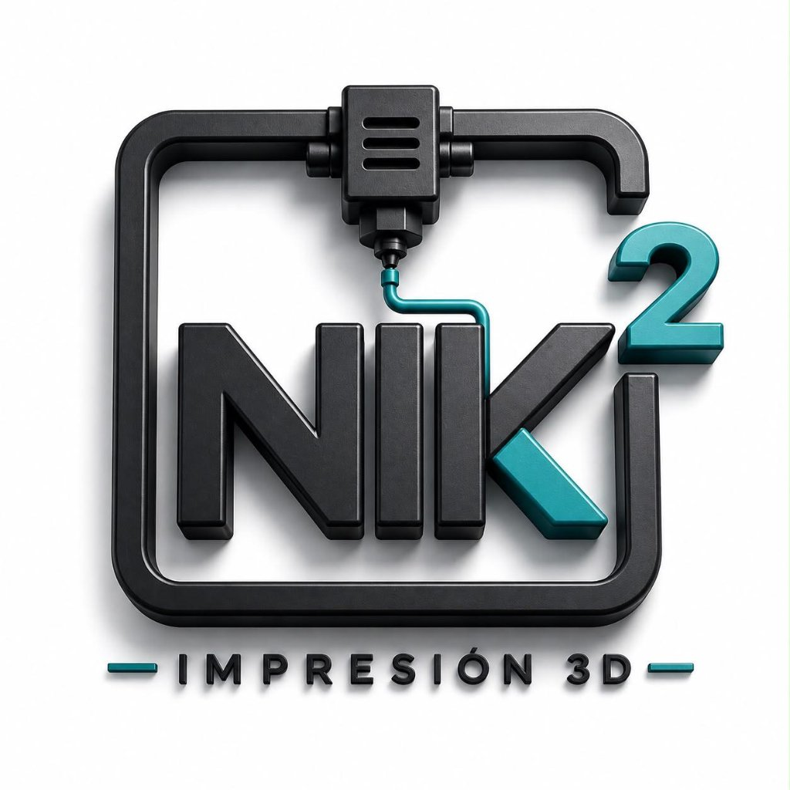

# Nikk Slicer · AI & MCP Server

**Unified 3D Slicer, MCP Server & Multi-Printer Farm Monitor for macOS & Windows — FLSUN Klipper/Moonraker + FlashForge LAN**  
*Unified 3D slicer, multi-object multicolor WebGL viewer, internal MCP server, and FDM farm control center with AI Copilot (DeepSeek / Gemini) for macOS and Windows.*

[](https://github.com/alzheimeer/nikk-slicer/releases/latest)
[](https://github.com/alzheimeer/nikk-slicer/actions/workflows/build-windows.yml)
[](https://fastapi.tiangolo.com/)
[](https://react.dev/)
[](https://www.deepseek.com/)
[](https://modelcontextprotocol.io/)
[](LICENSE)
[](https://github.com/alzheimeer/nikk-slicer/releases/latest)
[](https://github.com/alzheimeer/nikk-slicer/releases/latest)
[](https://paypal.me/niklaussMauricio)

[Features](#-key-features) • [Ecosystem & Hardware](#-ecosystem--supported-printers) • [MCP & AI](#-cross-platform-architecture-dual-ai--mcp-server) • [Gallery](#-interface-gallery) • [Architecture](#-system-architecture) • [Download & Install](#-download--installation-macos-dmg--windows-exe) • [API](#-main-rest--mcp-endpoints)

<br />

🌐 **Official Website (GitHub Pages):** [**https://alzheimeer.github.io/nikk-slicer/**](https://alzheimeer.github.io/nikk-slicer/)  
📥 **Official Cross-Platform Download:** [**GitHub Releases (`NikkSlicer_macOS.dmg` & `NikkSlicer_Windows_Setup.exe`)**](https://github.com/alzheimeer/nikk-slicer/releases/latest)

</div>

---

## Integrated Ecosystem

<div align="center">

|  | 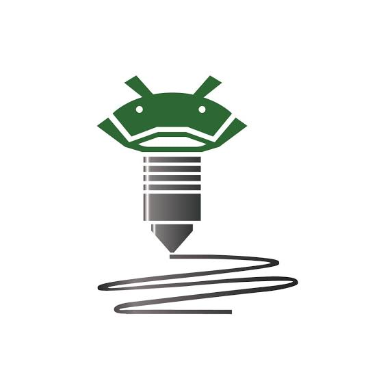 | 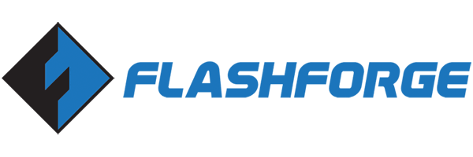 | 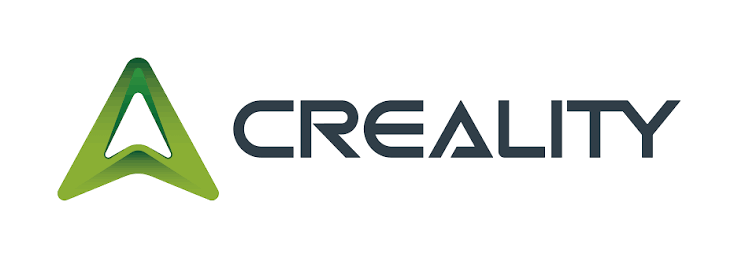 |
| :---: | :---: | :---: | :---: |
| **DeepSeek AI Copilot** | **Klipper / Moonraker** | **FlashForge LAN & Studio** | **Creality Marlin 2** |

</div>

Nikk Slicer brings the entire FDM production workflow into a single native desktop app (`Nikk Slicer.app` on macOS and `Nikk Slicer.exe` on Windows): `.STL` and `.3MF` geometric analysis, AI-assisted optimization powered by **DeepSeek / Google Gemini**, headless slicing with **OrcaSlicer / Flash Studio / FLSUN Slicer**, direct upload to network/USB/SD printers, and continuous telemetry recording (`0% → 100%`) with automated cross-run learning.

---

## Interface Gallery

| Slicer (Wizard) | Multicolor 3D Viewer (`T0–T3` · `paint_color`) |
| :---: | :---: |
| 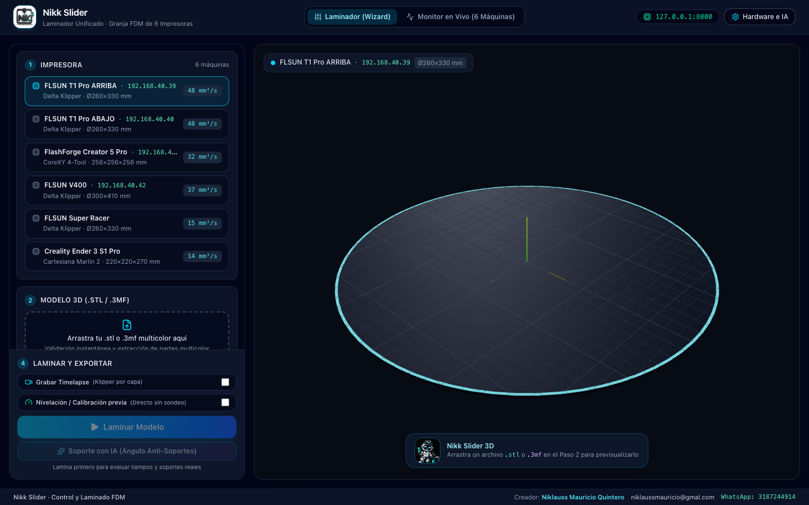 | 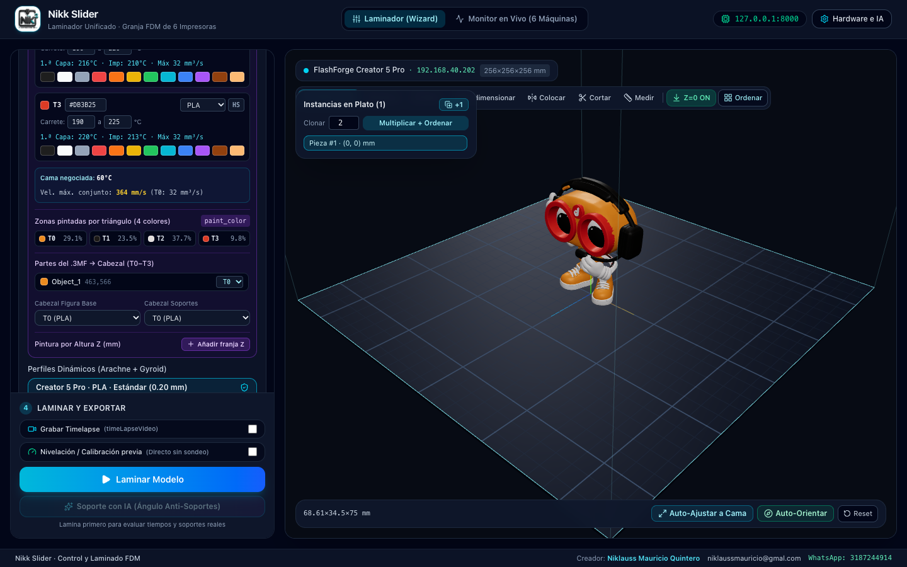 |

| Lithophane Mode (High Definition) | Live Farm Monitor & AI Compendiums |
| :---: | :---: |
| 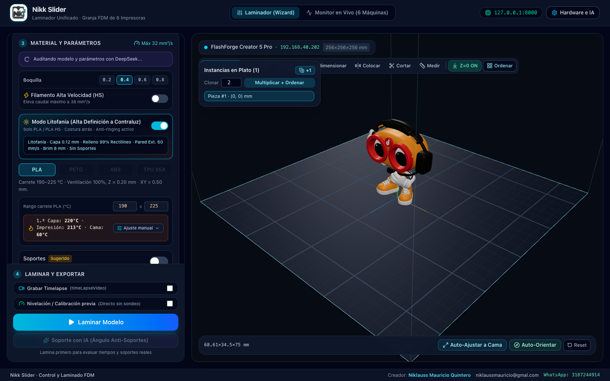 | 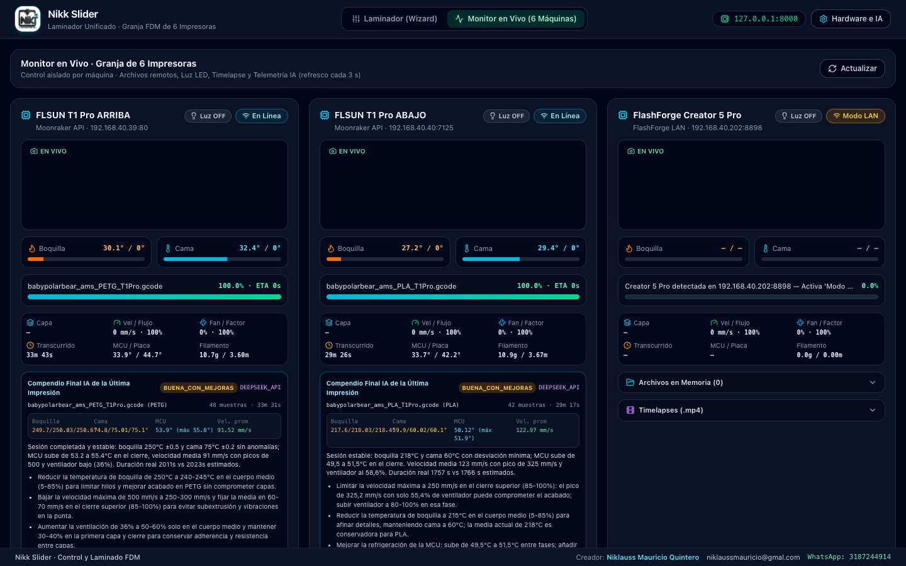 |

| 3D G-code Layers & AI Support | Multi-Printer, USB/SD & AI Key Management |
| :---: | :---: |
| 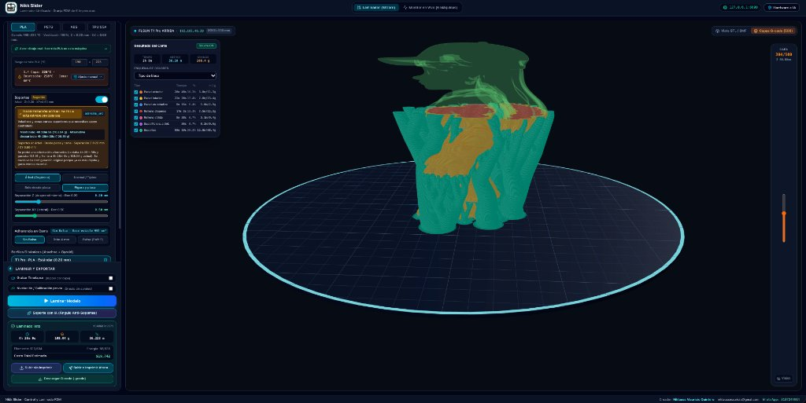 | 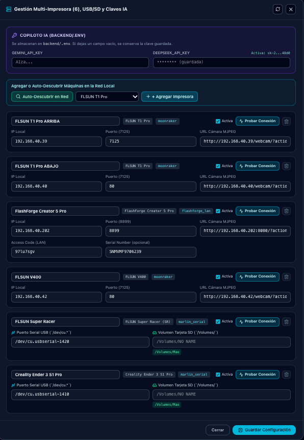 |

| Live Farm (Moonraker + FlashForge LAN) | Live Farm (V400 + USB Serial Marlin) |
| :---: | :---: |
| 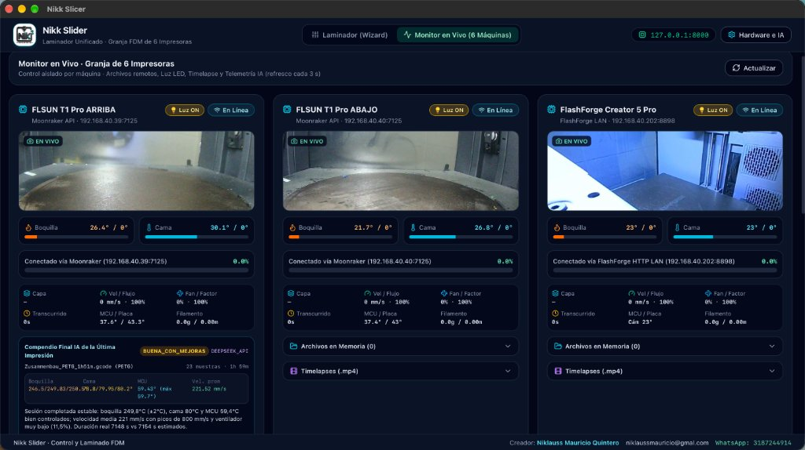 | 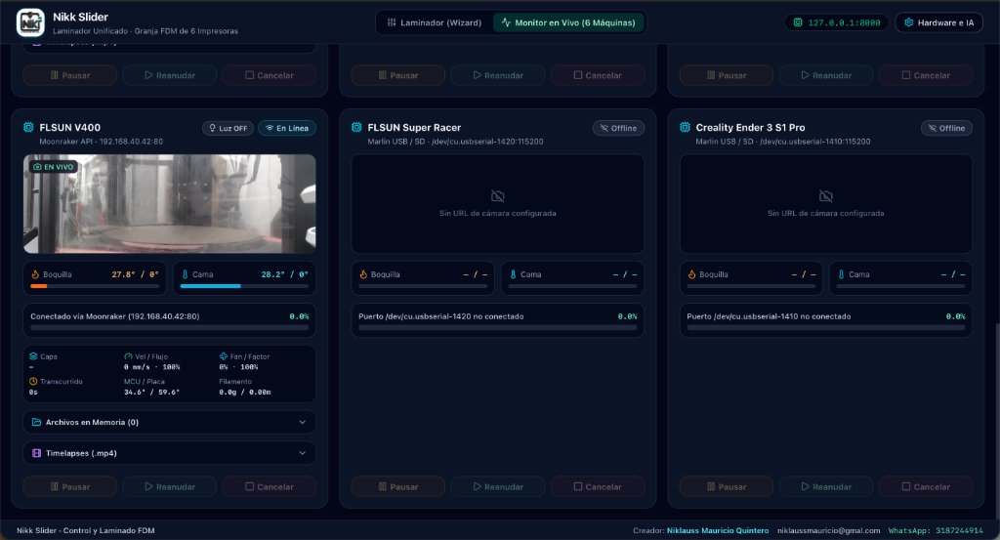 |

| Thermal Parameters per Spool | Dynamic Profiles (`Arachne + Gyroid`) |
| :---: | :---: |
| 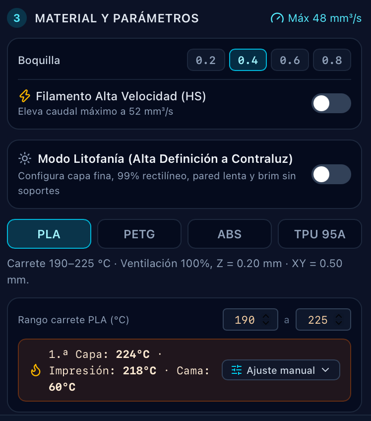 | 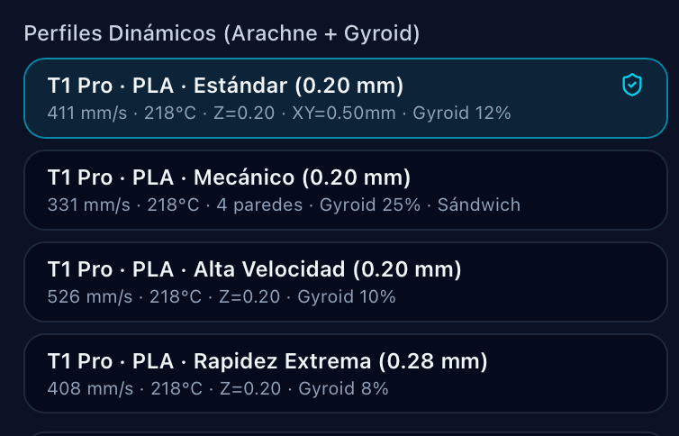 |

| Slice Ready, Costs & Upload | Final AI Compendium (`DeepSeek API`) |
| :---: | :---: |
| 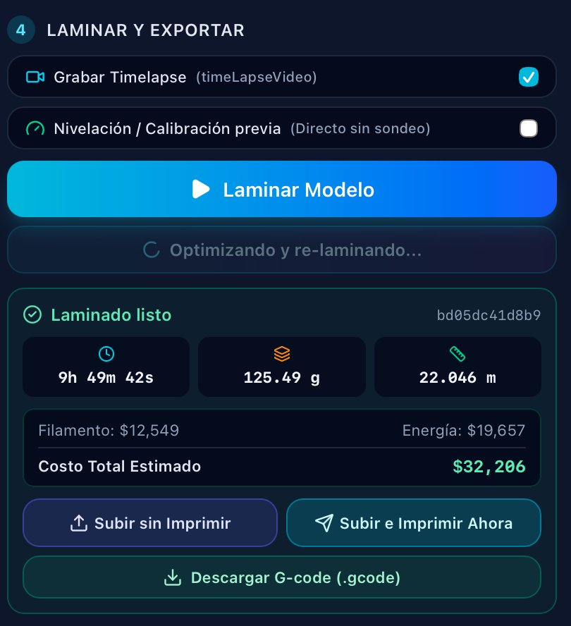 | 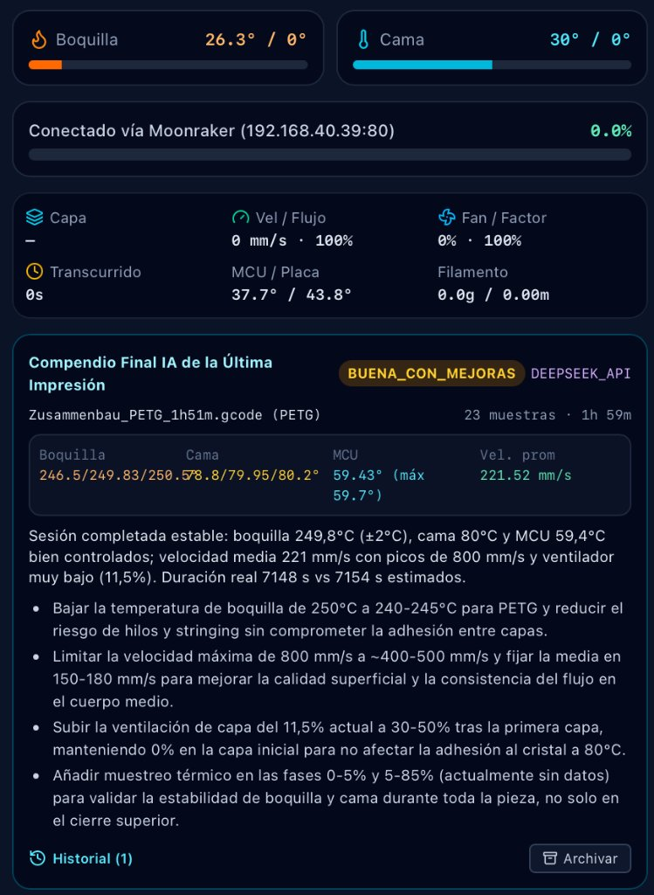 |

| Universal Printer Catalog (`273` Models) | Commercial 3D Quote Calculator (`COP$`) |
| :---: | :---: |
| 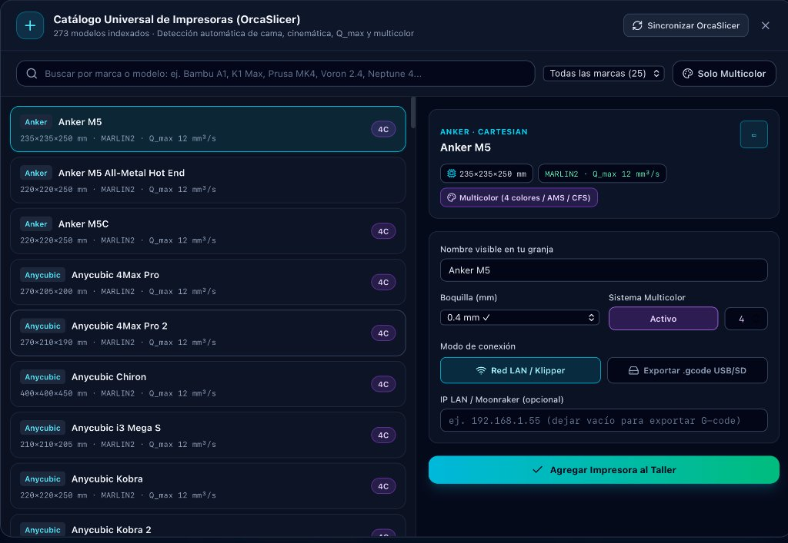 | 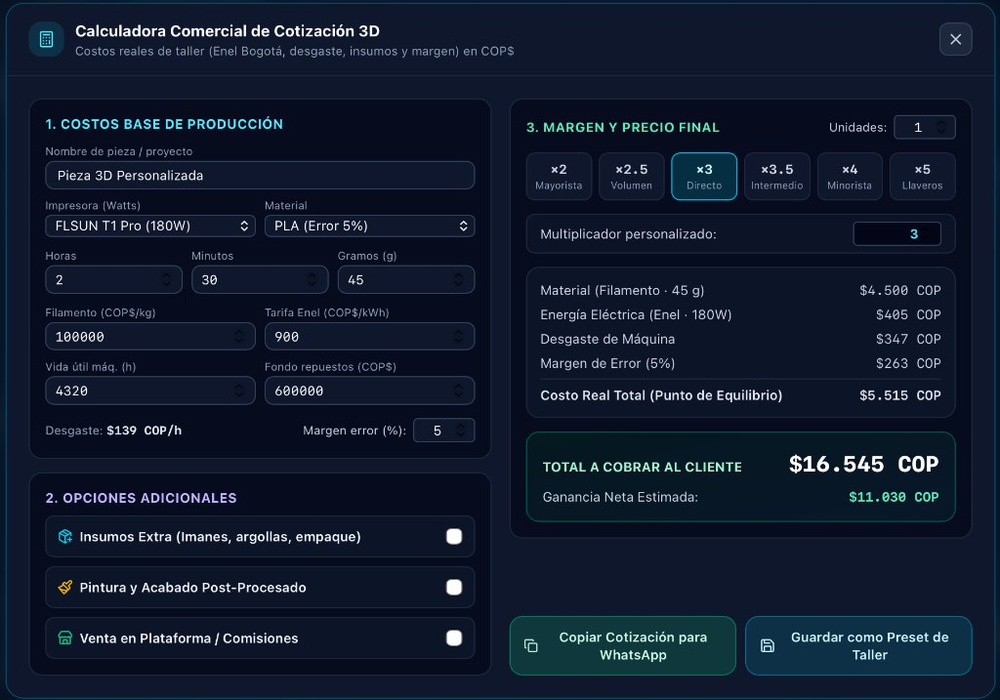 |

---

## Key Features

- **Universal Printer Catalog (`273` models · `25` brands from OrcaSlicer):**
  - Instant search by brand or model (Bambu, Creality, Prusa, Voron, Anker, Anycubic, Elegoo, FLSUN, FlashForge, etc.), brand filter, **`Solo Multicolor`** toggle, and **`Sync OrcaSlicer`** button.
  - Automatic detection of build volume, kinematics, `Q_max`, nozzle diameter (`0.4 mm`), multicolor system (`AMS / CFS / ACE / MMU`), and connection mode (**`LAN / Klipper`** with optional IP or **`Export .gcode USB/SD`**) to add any machine to your workshop in one click.
- **Independent Multi-Object `.3mf` Scene, Multi-Selection & CAD Gizmos (`Viewport3D.tsx`):**
  - When opening a multi-part `.3mf`, extracts each object independently while preserving its name, original position/rotation/scale, and `T0–T3` (`paint_color`) colors without merging them into a single block; includes geometric splitting (`POST /api/models/split-objects`) and bed auto-arrange.
  - **True multi-selection (`1`, `Multiple`, or `All`):** single click, `Shift/Cmd + Click`, box/marquee drag selection, and per-part checkboxes in the plate instance list.
  - **Always-visible `X / Y / Z` gizmos:** rendered with `depthTest = false`, `depthWrite = false`, and `renderOrder = 999` at the centroid of the selected object or group.
- **Project Manager, Native Menu & Multi-Window (`project_manager.py`):**
  - Native **`File`** menu (*New*, *Open Project* with 3D thumbnail gallery, *Save*, *Save As*, *Recent*) and startup dialog with **`Open Project`**, **`New Project`**, and **`Open Last Project`**.
  - Multi-window support with automatic distinctive header accent colors per project and real-time synchronized switcher tabs (`BroadcastChannel("nikk_slicer_windows")`).
- **Unified FlashForge LAN (`:8898`) Protocol & Global Blocking Progress Modal (`GlobalProcessingOverlay.tsx`):**
  - **`Upload without Printing`** (`printNow=false`) and **`Upload & Print Now`** (`printNow=true`) share the exact same FlashForge LAN HTTP (`:8898`) adapter with post-upload verification via `/gcodeList` and a progressive blocking overlay.
- **Smart Slicing with Dynamic Profiles (`0.08–0.28 mm`) & First-Layer Perfection:**
  - **Discrete Quality vs. Speed Slider (`0.08`, `0.12`, `0.16`, `0.20`, `0.24`, `0.28 mm`):** dynamically recalculates profile cards (*Standard*, *Mechanical / Structural*, *Fuzzy Skin / Texture*, *Lithophane HD* at `0.08–0.12 mm`, and *Armored Extreme Speed* at `0.24–0.28 mm`) within each printer's thermal and kinematic limits (`PLA`, `PETG`, `ABS`, `TPU`).
  - Optimized first layer, retraction/wipe/Z-hop `0.2 mm` for **PETG** and multicolor, fast travel moves, and close prime tower.
  - **Contextual AI Analysis (`POST /api/ai/analyze-model`):** covers all 6 resolutions with expandable variants, `Q_max`-based time estimates, and strict geometry/mode filtering.
  - Automatic nozzle/bed temperatures (`1st Layer` & `Print`), nozzle diameter (`0.2 / 0.4 / 0.6 / 0.8 mm`), and calibrated Z/XY support distances per material.
- **Multi-Option AI Auto-Orientation with Live 3D Preview (`POST /api/ai/orientations`):**
  - Evaluates 5 orientations (*Original*, *Back on Bed / Clean Face*, *45° Tilted*, *Minimum Time / Lowest Z*, *Maximum Stability / Wide Base*) with `trimesh` + AI and live `dropToBed` preview before slicing.
  - Measures real bed contact area (`z <= 0.25 mm`), emits stability warnings, and assigns accurate dynamic badges (`No Supports` only when overhangs are `<= 2.0%`).
- **Universal Layer Pause Manager (`POST /api/slicer/apply-pauses`):**
  - **`+ Pause here`** button with optional note and visual markers in the 3D G-code layer bar, plus the **Scheduled Pauses** card in Step 4 and summary in **Slice Ready**.
  - Instant injection into `.gcode` without re-slicing (`< 50 ms`), preserved across re-slices: `PAUSE` for **Klipper** printers and safe `G91 / G1 Z10 / M25 / G1 Z-10` block for **FlashForge Creator 5 Pro**.
- **AI Support Optimization (Real Before vs. After):**
  - Evaluates orientation candidates with `trimesh`, applies recommended rotation/settings, **actually re-slices** in the background, and compares time, total grams, and support weight against the previous slice; reverts automatically if there is no net improvement.
- **4-Extruder Multi-Head (`T0–T3`) & Extended (+4 Colors) Mapping for FlashForge Creator 5 Pro:**
  - Native decoding of **triangle-painted `.3mf`** files (`paint_color` from Bambu/Orca/Meshy AI and `pid`/`p1`) in both the WebGL 3D viewer and headless slicer.
  - **Extended Multicolor Mapping (+4 Colors):** analyzes `[z_min_mm, z_max_mm]` per part after rotation/scale, suggests reusable physical `T0–T3` slots without Z overlap, validates conflicts live, and injects `M25` filament-change pauses automatically.
  - Independent material, temperature, `HS` mode, spool range, and retraction per toolhead (`T0–T3`), plus an **Ultra-Saving Prime Tower** (`20 mm` + flush into infill/supports).
- **Lithophane Mode (Backlit High Definition):**
  - Automatic lock to **PLA / PLA HS**, fine layers (`0.08–0.12 mm`), **`99%` rectilinear infill**, 6 perimeters (`Arachne`), rear seam, `8 mm` outer brim, support exclusion on the image face, and anti-ringing speed/acceleration limits.
- **Commercial 3D Quote Calculator (`QuoteCalculatorModal`):**
  - Accessible from **Slice Ready** (pre-filled with printer/Watts, print time, and grams) or from the top bar (**Quote**).
  - Computes real workshop costs in `COP$` (filament, electricity tariff, machine wear/spares, error margin, extra hardware, post-processing, platform fees, and `×2`–`×5` multipliers), with **WhatsApp** formatted copy and workshop preset saving.
- **Live Farm Monitor, 5-Min Camera Auto-Sleep & Continuous AI Learning:**
  -  **Continuous background recorder (`0% → 100%`)** saving telemetry every 20 s and at progress milestones (`backend/temp/telemetry_sessions/`).
  - **5-minute camera auto-sleep** in `FarmDashboard.tsx` (with fullscreen modal and `aspect-4/3 object-contain` full FOV) to reduce CPU/network load.
  - Generates a **Final AI Compendium** by print phase (`0–5%`, `5–85%`, `85–100%`) with grading and concrete improvements for the next slice, feeding accumulated learnings (`GET /api/telemetry/learnings`) back into Step 3.
  - Isolated **LED Light** control, remote **file manager** (upload without printing, upload & print with/without bed leveling, and **bulk delete**), `.mp4` **Timelapse** player/download, and real cancellation (`END_PRINT`).
- **Real-Time Production Cost Estimation:**
  - Automatic estimate of **filament cost**, **electricity consumption**, and **total part cost** alongside print time, grams, and meters before uploading or downloading `.gcode`.

---

## Cross-Platform Architecture, Dual AI & MCP Server

- **Automatic Slicer Detection (`backend/app/core/platform_detector.py`):**
  - Unified user data folder (`~/.nikk_slicer/` on macOS/Linux and `%APPDATA%\NikkSlicer\` on Windows) with zero hardcoded dev paths.
  - Fast deterministic scanning on `darwin` and `win32` for **OrcaSlicer**, **Orca-Flashforge / Flash Studio**, and **FLSun Slicer**, automatically updating the active CLI executable.
- **`Environment / MCP` Assistant (`SystemSetupModal.tsx`):**
  - Opens automatically on first launch if the primary slicer is missing and remains accessible anytime from **`Environment / MCP`** in the top bar.
  - Lets you re-scan your machine, open official download links, pick an executable manually (`DesktopApi.pick_slicer_executable`), and test AI connectivity.
- **Dual BYOK API Key Support (DeepSeek / Google Gemini):**
  - Choose between **DeepSeek** or **Google Gemini** and enter your own API Key inside `Environment / MCP` (`POST /api/system/ai-config` + `POST /api/system/ai-test`).
- **Self-Discovered Internal MCP Server (`backend/app/mcp_server.py`):**
  - Built on the official `mcp` SDK (`MCPServer("NikkSlicerMCP")`), exposing **19 tools** and **3 resources** (`nikk://printers`, `nikk://projects/recent`, `nikk://environment`).
  - Available via **Streamable HTTP** at `http://127.0.0.1:8000/mcp` (mounted on FastAPI) and via **`stdio`** (`python3 -m backend.app.mcp_server`), with one-click JSON config copy in `Environment / MCP`.

---

## Ecosystem & Supported Printers

<div align="center">

| 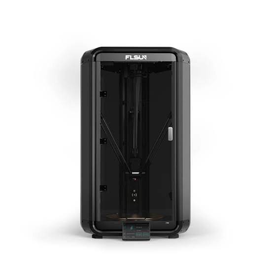 |  | 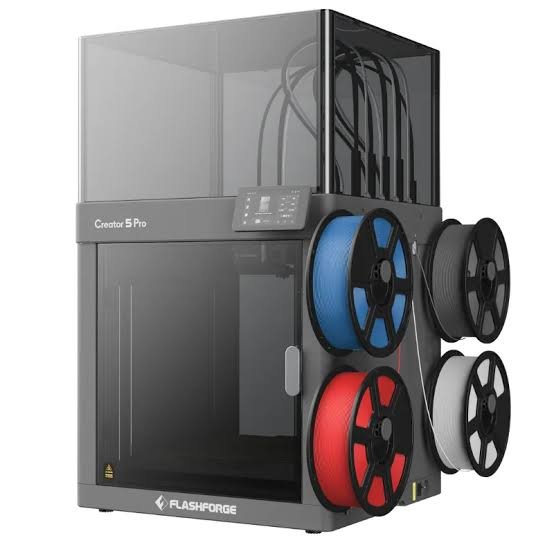 | 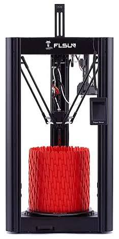 | 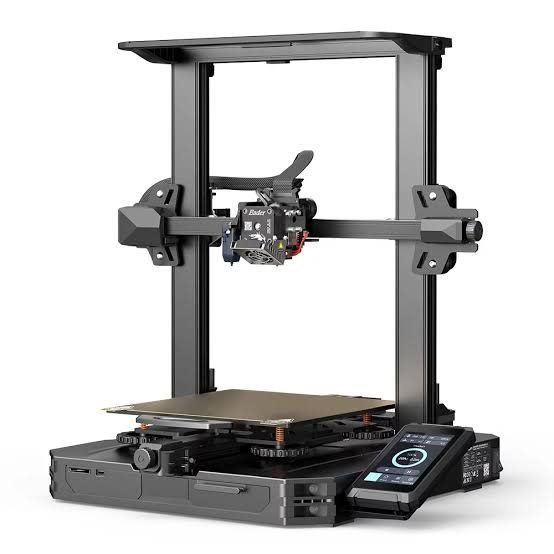 |
| :---: | :---: | :---: | :---: | :---: |
| **FLSUN T1 Pro (#1/#2)**<br />Delta Klipper · `Ø260×330` | **FLSUN V400**<br />Delta Klipper · `Ø300×410` | **Creator 5 Pro**<br />CoreXY 4-Tool (`T0–T3`) | **FLSUN Super Racer**<br />Delta · `Ø260×330` · `15 mm³/s` | **Ender 3 S1 Pro**<br />Marlin 2 · `220×220×270` |

</div>

| Printer | Base Profile | Kinematics | Build Volume | Protocol |
| :--- | :--- | :--- | :--- | :--- |
| **FLSUN T1 Pro #1 / #2** | `flsun_t1_pro` | Delta Klipper | `Ø260 × 330 mm` | Moonraker HTTP (`:7125`) + MJPEG Camera |
| **FLSUN V400** | `flsun_v400` | Delta Klipper | `Ø300 × 410 mm` | Moonraker HTTP (`:80`) + MJPEG Camera |
| **FlashForge Creator 5 Pro** | `creator5_pro` | CoreXY 4-Tool (`T0–T3`) | `256 × 256 × 256 mm` | FlashForge LAN (`:8898` / TCP `:8899`) |
| **FLSUN Super Racer** | `flsun_sr` | Delta Marlin/Klipper | `Ø260 × 330 mm` | USB Serial (`pyserial`) / SD |
| **Creality Ender 3 S1 Pro** | `ender3_s1_pro` | Cartesian Marlin 2 | `220 × 220 × 270 mm` | USB Serial (`pyserial`) / SD Volume |

---

## System Architecture

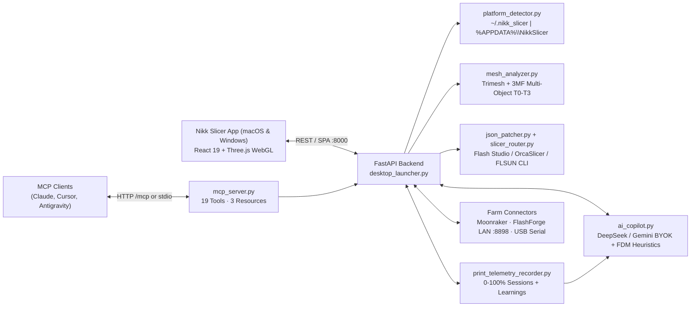

```text
nikk-slicer/
├── .github/workflows/
│   ├── build-macos.yml                  # CI/CD macOS pipeline -> NikkSlicer_macOS.dmg
│   └── build-windows.yml                # CI/CD Windows pipeline -> NikkSlicer_Windows_Setup.exe
├── backend/
│   ├── app/
│   │   ├── main.py                      # FastAPI API + SPA server (:8000) + /mcp mount
│   │   ├── mcp_server.py                # Internal MCP server (19 tools + 3 resources)
│   │   ├── config.py                    # Catalog, optimal temperatures & T0–T3 negotiation
│   │   ├── connectors/                  # moonraker.py, flashforge_lan.py, marlin_serial.py
│   │   ├── core/                        # platform_detector.py, mesh_analyzer.py, json_patcher.py,
│   │   │                                # slicer_router.py, gcode_postprocessor.py, ai_copilot.py,
│   │   │                                # print_telemetry_recorder.py, project_manager.py, project_store.py
│   │   └── models/schemas.py            # Pydantic schemas
│   ├── profiles/                        # Master JSON profiles (machines, filaments, process)
│   ├── printers_config.json             # Farm IPs, ports & metadata
│   ├── requirements.txt
│   └── .env.example
├── frontend/
│   ├── src/components/                  # SlicerWizard.tsx, Viewport3D.tsx, FarmDashboard.tsx,
│   │                                    # SystemSetupModal.tsx, GlobalProcessingOverlay.tsx,
│   │                                    # QuoteCalculatorModal.tsx, ErrorJournalModal.tsx
│   ├── src/i18n/                        # Bilingual ES / EN translations & React context
│   ├── src/services/api.ts
│   ├── src/utils/threeMfPaint.ts        # Triangle-painted 3MF decoder (WebGL)
│   └── dist/                            # Production React/Vite build served by FastAPI
├── docs/
│   ├── assets/                          # DeepSeek/Klipper/FlashForge/Creality logos & photos
│   └── screenshots/                     # Real application screenshots
├── desktop_launcher.py                  # Cross-platform macOS & Windows launcher (port 8000 + native menus)
├── build_macos_app.sh                   # Self-contained PyInstaller Nikk Slicer.app packager
├── build_macos_dmg.sh                   # NikkSlicer_macOS.dmg generator (UDZO + /Applications)
├── build_windows.ps1                    # Windows PyInstaller --onedir + nikk_slicer.ico packager
├── installer_windows.iss                # Inno Setup 6 script -> NikkSlicer_Windows_Setup.exe
├── install_on_mac.sh                    # Automated macOS source installer (.venv + .env + app)
├── package_release.sh                   # Local dist_release/ packager
├── LICENSE                              # MIT License
├── README.md                            # Spanish README
└── README.en.md                         # English README
```

---

## Download & Installation (macOS `.dmg` & Windows `.exe`)

Download the installer for your OS from [**GitHub Releases**](https://github.com/alzheimeer/nikk-slicer/releases/latest):

- **macOS (Apple Silicon & Intel):** **`NikkSlicer_macOS.dmg`** (100% self-contained `Nikk Slicer.app` bundle with Python runtime, dependencies, and frontend included).
- **Windows 10 / 11 (x64):** **`NikkSlicer_Windows_Setup.exe`** (Inno Setup installer with Edge WebView2, Desktop/Start Menu shortcuts, and optional `.3mf` / `.stl` file associations).

### 1. Quick Install
- **On macOS:** open [**`NikkSlicer_macOS.dmg`**](https://github.com/alzheimeer/nikk-slicer/releases/latest/download/NikkSlicer_macOS.dmg) and drag **`Nikk Slicer.app`** into **`Applications`**.
  > **macOS note (first launch):** because the app uses a local ad-hoc signature, if macOS displays an unidentified developer prompt on first launch, **right-click → Open** or run `xattr -cr "/Applications/Nikk Slicer.app"`.
- **On Windows:** download and run [**`NikkSlicer_Windows_Setup.exe`**](https://github.com/alzheimeer/nikk-slicer/releases/latest/download/NikkSlicer_Windows_Setup.exe), complete the wizard (optionally check `.3mf` / `.stl` associations), and launch **Nikk Slicer** from the Start Menu or Desktop.

### 2. Automatic Slicer Engine Detection
On startup, Nikk Slicer automatically scans your computer (no manual paths required) for:
- **OrcaSlicer** (`/Applications/OrcaSlicer.app` on macOS · `orca-slicer.exe` on Windows)
- **FLSun Slicer** (`/Applications/FlsunSlicer.app` on macOS · `FlsunSlicer.exe` on Windows)
- **Orca-Flashforge / Flash Studio / FlashPrint** (`/Applications/Flash Studio.app` / `Orca-Flashforge.app` on macOS · `Orca-Flashforge.exe` / `FlashPrint.exe` on Windows)

If any engine is missing, the **`Environment / MCP`** assistant provides official download links and a manual executable picker.

### 3. Get Your DeepSeek (or Google Gemini) API Key
Open **`Environment / MCP`** in the top bar to pick your AI provider (**DeepSeek** or **Google Gemini**), paste your API Key, and verify it with **`Test connection`** (stored locally in `~/.nikk_slicer/` on macOS/Linux or `%APPDATA%\NikkSlicer\` on Windows).

> 🔑 **Get your DeepSeek API Key:** [**https://platform.deepseek.com/sign_in**](https://platform.deepseek.com/sign_in)
> 1. Sign in to **DeepSeek Platform** and go to **`Top up`**. **Just $5 USD goes a very long way:** in real-world usage, over **350 AI queries (~500K tokens) cost less than $0.10 USD**, so $5 USD lasts for months of model analyses, orientation checks, and print compendiums.
> 2. Open **`API keys` → `Create new API key`**, copy your key (`sk-...`), and paste it into **`Environment / MCP`** inside Nikk Slicer.

### 4. Connect the MCP Server (`nikk-slicer`) in Antigravity IDE, Claude Desktop, or Cursor
Nikk Slicer exposes **19 MCP tools** and **3 MCP resources** over **Streamable HTTP** (`http://127.0.0.1:8000/mcp` while the app is open) and **`stdio`** (`python3 -m backend.app.mcp_server`):

- **Streamable HTTP (Antigravity IDE / Cursor — with Nikk Slicer running):**
  ```json
  {
    "mcpServers": {
      "nikk-slicer": {
        "url": "http://127.0.0.1:8000/mcp"
      }
    }
  }
  ```
- **Local stdio (Claude Desktop / Antigravity IDE / Cursor — works even when the UI is closed):**
  ```json
  {
    "mcpServers": {
      "nikk-slicer": {
        "command": "/path/to/nikk-slicer/backend/.venv/bin/python",
        "args": ["-m", "backend.app.mcp_server"],
        "env": {
          "PYTHONPATH": "/path/to/nikk-slicer"
        }
      }
    }
  }
  ```
  You can also copy the ready-to-paste JSON snippet directly from **`Environment / MCP` → `Copy MCP JSON Config`**.

#### MCP Tools & Resources Catalog (`19` Tools · `3` Resources)
| Category | MCP Tools |
| :--- | :--- |
| **Environment & AI** | `nikk_get_system_environment`, `nikk_rescan_slicers`, `nikk_set_slicer_path`, `nikk_configure_ai` |
| **3D Geometry & `.3mf`** | `nikk_analyze_model`, `nikk_split_objects`, `nikk_auto_arrange`, `nikk_evaluate_orientations` |
| **AI Copilot & Slicing** | `nikk_ai_analyze_model`, `nikk_slice_model`, `nikk_apply_layer_pauses`, `nikk_calculate_quote` |
| **Projects `.nikkproj`** | `nikk_list_recent_projects`, `nikk_get_project`, `nikk_delete_project` |
| **Farm & Error Journal** | `nikk_get_printers_status`, `nikk_upload_and_print`, `nikk_control_printer`, `nikk_get_error_journal` |
| **MCP Resources** | `nikk://printers`, `nikk://projects/recent`, `nikk://environment` |

### Building from Source (Optional)
- **macOS (`.app` and `.dmg`):**
  ```bash
  git clone https://github.com/alzheimeer/nikk-slicer.git
  cd nikk-slicer
  ./build_macos_dmg.sh   # outputs dist_release/NikkSlicer_macOS.dmg
  ```
- **Windows (`.exe`):**
  ```powershell
  .\build_windows.ps1    # outputs dist_release/NikkSlicer_Windows_Setup.exe
  ```

### Local Network Access (Zero-Install on Secondary Devices)
If `NIKKSLICER_HOST=0.0.0.0` and `NIKKSLICER_PORT=8000` are set in `backend/.env`, open Nikk Slicer on your main workstation and access it from any Mac, Windows PC, or iPad on your LAN at:
```text
http://<MAIN_MACHINE_IP>:8000
```

---

## Main REST & MCP Endpoints

| Method | Path | Description |
| :--- | :--- | :--- |
| `GET` | `/api/health` | Unified server health check (`Nikk Slicer`) |
| `GET` | `/api/system/environment` | Detected OS, user data directory, installed slicers & AI/MCP config |
| `POST` | `/api/system/rescan` | Re-scans OrcaSlicer, Orca-Flashforge, and FLSun Slicer |
| `POST` | `/api/system/set-slicer-path` | Manually assigns a slicer executable path |
| `POST` | `/api/system/ai-config` | Saves AI provider (`deepseek` / `gemini`) and API Key |
| `POST` | `/api/system/ai-test` | Live connection test for DeepSeek or Google Gemini |
| `HTTP / stdio` | `/mcp` | Internal MCP server (`19` tools + `3` resources) |
| `POST` | `/api/analyze-mesh` | Geometric analysis (`trimesh`), `.3mf` multi-object extraction & Z ranges |
| `POST` | `/api/models/split-objects` | Geometric split of compound meshes into independent objects |
| `POST` | `/api/ai/orientations` | Multi-orientation evaluation (`trimesh` + AI) with physical feasibility |
| `POST` | `/api/ai/analyze-model` | Contextual AI analysis across 6 layer heights (`0.08–0.28 mm`) |
| `POST` | `/api/ai-recommend` | Automatic recommendation using AI + real learnings |
| `POST` | `/api/ai-support-orient` | Anti-support orientation & comparative re-slice evaluation |
| `POST` | `/api/slice` | Multi-profile, multi-extruder (`T0–T3`) slicing & layer pauses |
| `POST` | `/api/slicer/apply-pauses` | Instant pause injection (`PAUSE` / `M25`) without re-slicing |
| `GET / POST` | `/api/projects/*` | Save, list with 3D thumbnails, and reopen `.nikkproj` / recent projects |
| `GET` | `/api/printers/status` | Live telemetry for the entire farm + continuous ingestion |
| `GET` | `/api/printers/{id}/telemetry-session` | Active recorded session (`0–100%`) & compendium history |
| `POST` | `/api/printers/{id}/telemetry-session/compendium` | Generates accumulated AI compendium on demand |
| `GET` | `/api/telemetry/learnings` | Accumulated real learnings per machine and material |

---

## Updating & Rebuilding After Code Changes

- **macOS — Rebuild frontend and update `Nikk Slicer.app` + `/Applications/Nikk Slicer.app`:**
  ```bash
  ./build_macos_app.sh
  ```
- **macOS — Generate distributable `dist_release/NikkSlicer_macOS.dmg`:**
  ```bash
  ./build_macos_dmg.sh
  ```
- **Windows — Rebuild frontend and generate `dist_release/NikkSlicer_Windows_Setup.exe`:**
  ```powershell
  .\build_windows.ps1
  ```

---

## Support the Project (Optional)

**Nikk Slicer** is **100% free and open source (MIT)**. If this tool saves you time in your workshop or 3D printing farm, you can optionally support its development and real-world testing through any of these channels:

- **International (PayPal):** [paypal.me/niklaussMauricio](https://paypal.me/niklaussMauricio)
- **Colombia — Bre-B Key (instant zero-fee transfer):** `@NIKLAUSS`
- **Colombia — Nequi:** `319 377 9313`

---

## License & Author

Distributed under the **[MIT](LICENSE)** License · © 2026 **Niklauss Mauricio Quintero Romero** (`niklaussmauricio@gmail.com`)
