<div align="center">

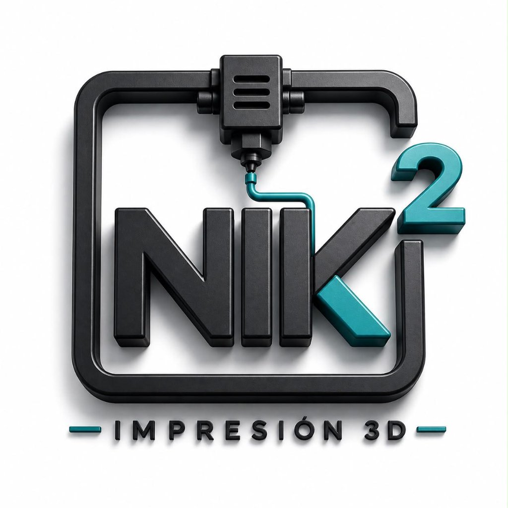

# Nikk Slicer

**Unified 3D Slicer & Multi-Printer Farm Monitor for macOS — FLSUN Klipper/Moonraker + FlashForge LAN**  
*Laminador 3D unificado, visor WebGL multicolor y centro de control de granja FDM con Copiloto IA para macOS.*

[](https://github.com/alzheimeer/nikk-slicer/releases/latest)
[](https://fastapi.tiangolo.com/)
[](https://react.dev/)
[](https://www.deepseek.com/)
[](LICENSE)
[-22c55e?logo=apple&logoColor=white)](https://github.com/alzheimeer/nikk-slicer/releases/latest)
[](https://paypal.me/niklaussMauricio)

[Características](#-características-principales) • [Ecosistema & Hardware](#-ecosistema-e-impresoras-soportadas) • [Galería](#-galería-de-interfaces) • [Arquitectura](#-arquitectura-del-sistema) • [Instalación](#-instalación-en-otro-mac-apple-silicon-m1m2m3m4-e-intel) • [API](#-endpoints-rest-principales)

<br />

📥 **Descarga directa para macOS (Apple Silicon M1–M4 e Intel):** [**NikkSlicer_macOS_Installer.dmg (v1.3.0)**](https://github.com/alzheimeer/nikk-slicer/releases/latest)

</div>

---

## Ecosistema Integrado

<div align="center">

|  |  |  | 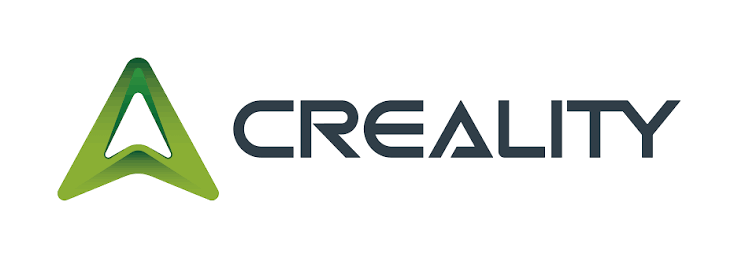 |
| :---: | :---: | :---: | :---: |
| **DeepSeek AI Copilot** | **Klipper / Moonraker** | **FlashForge LAN & Studio** | **Creality Marlin 2** |

</div>

Nikk Slicer integra en una sola aplicación nativa (`Nikk Slicer.app`) todo el flujo de producción FDM: análisis geométrico de `.STL` y `.3MF`, optimización automática impulsada por **DeepSeek API**, laminado headless con **Flash Studio / OrcaSlicer**, envío directo a impresoras en red/USB/SD y grabación continua de telemetría (`0% → 100%`) con aprendizaje automático entre corridas.

---

## Galería de Interfaces

| Laminador (Wizard) | Visor 3D Multicolor (`T0–T3` · `paint_color`) |
| :---: | :---: |
| 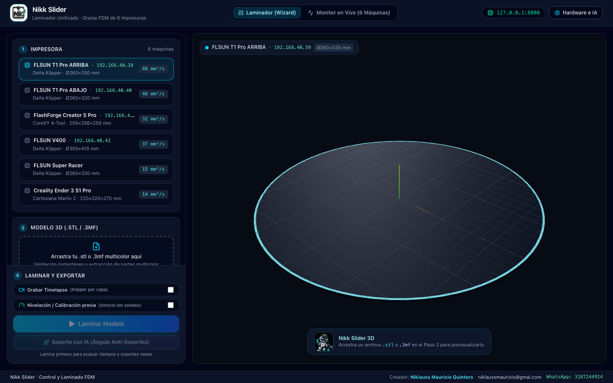 |  |

| Modo Litofanía (Alta Definición) | Monitor en Vivo & Compendios IA |
| :---: | :---: |
| 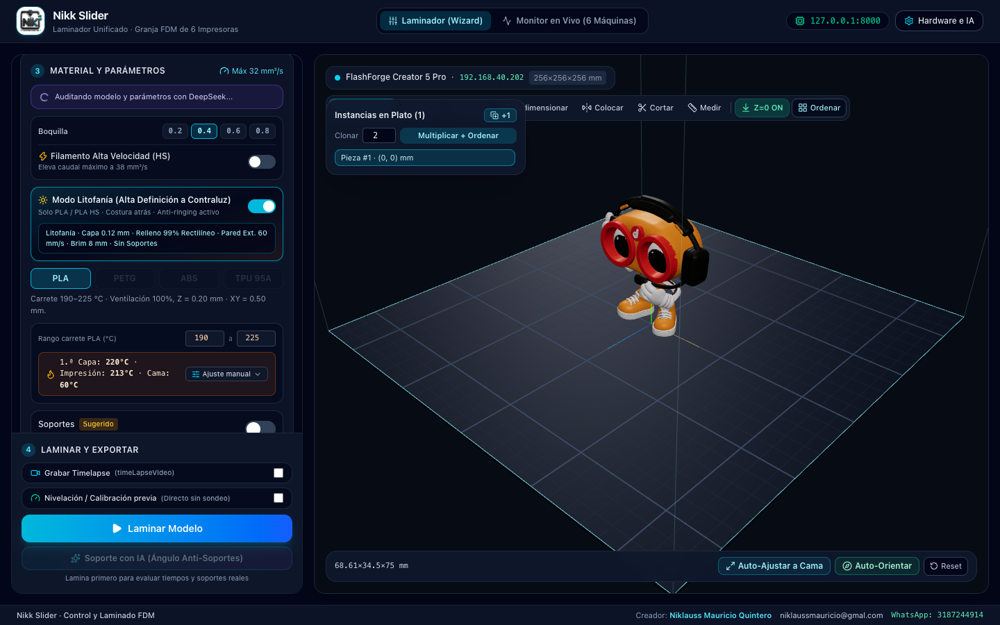 | 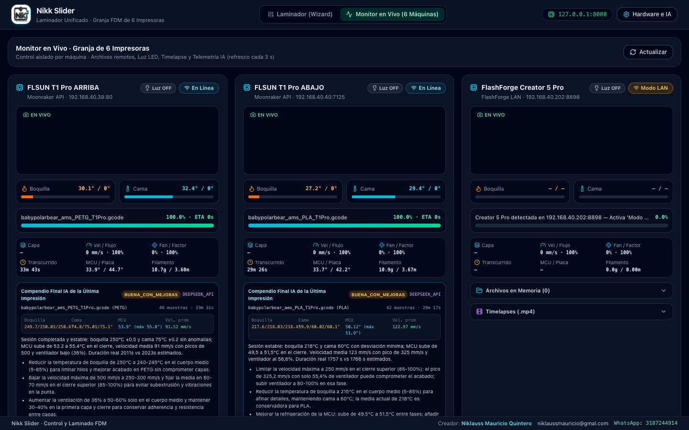 |

| Capas G-code 3D & Soporte con IA Real | Gestión Multi-Impresora, USB/SD y Claves IA |
| :---: | :---: |
| 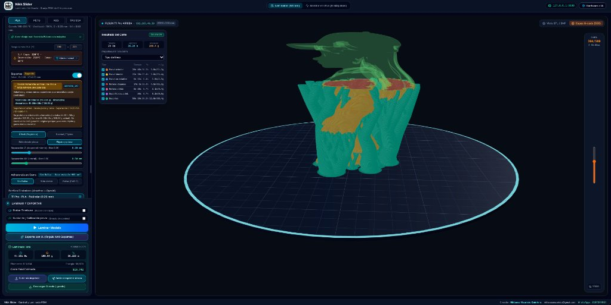 |  |

| Granja en Vivo (Moonraker + FlashForge LAN) | Granja en Vivo (V400 + USB Serial Marlin) |
| :---: | :---: |
| 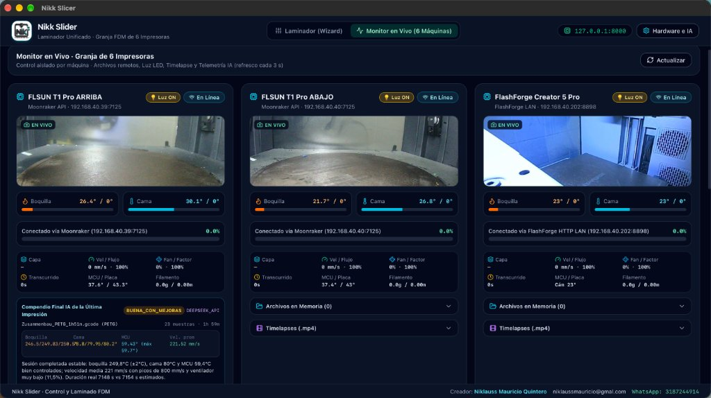 |  |

| Parámetros Térmicos por Carrete | Perfiles Dinámicos (`Arachne + Gyroid`) |
| :---: | :---: |
| 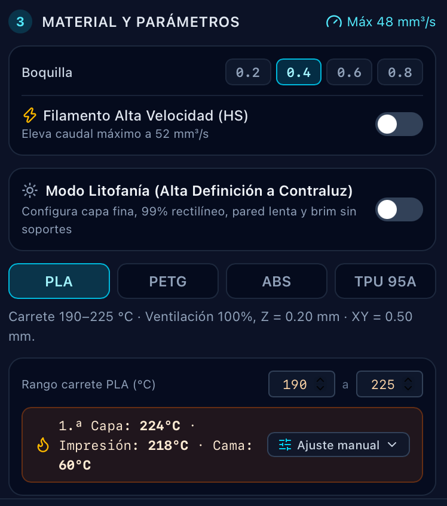 | 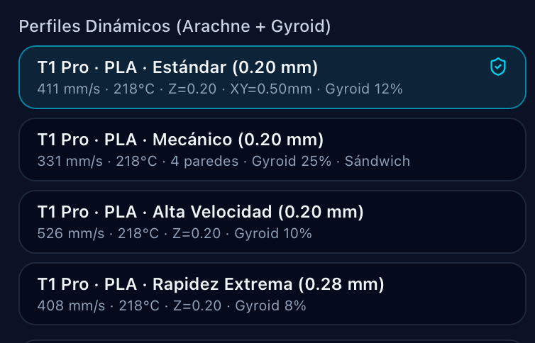 |

| Laminado Listo, Costos y Envío | Compendio Final IA (`DeepSeek API`) |
| :---: | :---: |
|  | 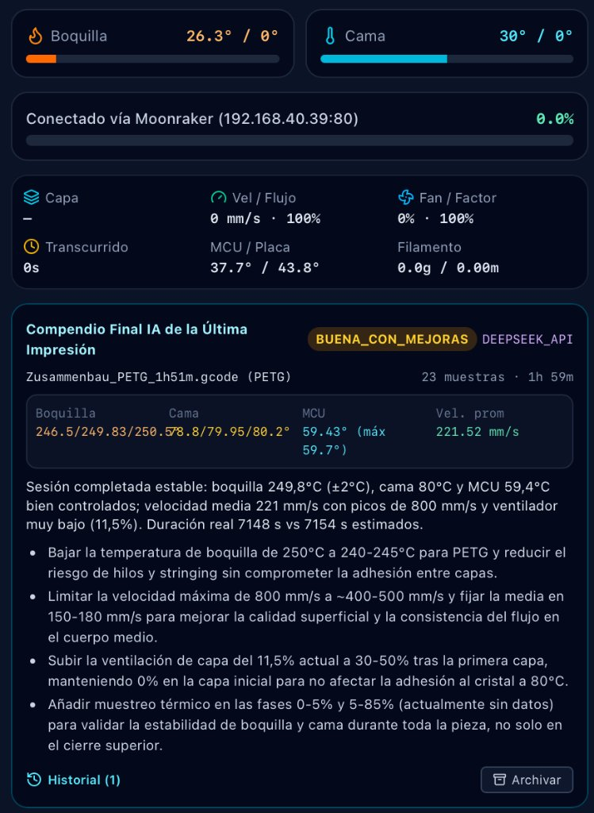 |

---

## Características Principales

- **Laminado Inteligente con Perfiles Dinámicos (`0.08–0.28 mm`):**
  - **Slider Discreto Calidad vs. Velocidad (`0.08`, `0.12`, `0.16`, `0.20`, `0.24`, `0.28 mm`):** recalcula en tiempo real tarjetas dinámicas (*Estándar*, *Mecánico / Estructural*, *Piel Difusa / Textura*, *Litofanía HD* en `0.08–0.12 mm` y *Rapidez Extrema Blindada* en `0.24–0.28 mm`) según los límites térmicos/cinemáticos de cada impresora y material (`PLA`, `PETG`, `ABS`, `TPU`).
  - **Análisis IA Contextual (`POST /api/ai/analyze-model`):** cubre las 6 resoluciones con variantes desplegables, tiempos estimados según `Q_max` y filtrado estricto por geometría/modo (en Litofanía oculta materiales incompatibles y restringe alturas a `0.08 / 0.12 mm`).
  - Cálculo automático de temperaturas (`1.ª Capa` e `Impresión`), diámetro de boquilla (`0.2 / 0.4 / 0.6 / 0.8 mm`) y separación calibrada de soportes Z/XY por material.
- **Auto-Orientación IA Multi-Opción con Previsualización 3D en Vivo (`POST /api/ai/orientations`):**
  - Evalúa con `trimesh` + DeepSeek IA 5 orientaciones (*Posición Original*, *Espalda en Cama / Cara Libre*, *Inclinado 45°*, *Mínimo Tiempo / Menor Altura Z* y *Máxima Estabilidad / Base Amplia*) con previsualización instantánea en el visor 3D sobre la cama (`dropToBed`) antes de laminar.
  - Mide el área real de contacto en cama (`z <= 0.25 mm`), emite alertas de estabilidad (`Base muy pequeña · Requiere Brim/Balsa y Soportes`) y asigna badges dinámicos reales (`Sin Soportes` únicamente cuando los voladizos son `<= 2.0%`).
- **Gestor Universal de Pausas por Capa (`POST /api/slicer/apply-pauses`):**
  - Botón **`+ Pausa aquí`** (con nota opcional) y marcadores visuales en la barra vertical de capas del visor G-code, además del bloque **Pausas Programadas** en el Paso 4 y resumen en **Laminado listo**.
  - Inyección instantánea en el `.gcode` sin re-laminar (`< 50 ms`) y conservación automática al volver a laminar: `PAUSE` para impresoras **Klipper** y bloque seguro `G91 / G1 Z10 / M25 / G1 Z-10` para **FlashForge Creator 5 Pro**.
- **Soporte con IA (Antes vs. Después Real):**
  - Al pulsar **Soporte con IA (Ángulo Anti-Soportes)**, el sistema evalúa candidatos de orientación con `trimesh`, aplica la rotación y configuración recomendadas, **re-lamina realmente** en segundo plano y compara tiempo, gramos totales y peso de soporte contra el corte previo; si no mejora, revierte automáticamente a la configuración original.
- **Multicabezal 4 Extrusores (`T0–T3`) y Mapeo Extendido (+4 Colores) para FlashForge Creator 5 Pro:**
  - Decodificación nativa de archivos **`.3mf` pintados por triángulo** (`paint_color` de Bambu/Orca/Meshy AI y `pid`/`p1`) tanto en el visor 3D (sin sangrado entre vértices) como en el laminador headless.
  - **Mapeo Extendido Multicolor (+4 Colores):** analiza rangos `[z_min_mm, z_max_mm]` por parte tras rotación/escala, sugiere ranuras físicas `T0–T3` reutilizables sin cruce en Z, valida conflictos en vivo e inyecta automáticamente la pausa `M25` en el cambio de filamento.
  - Configuración térmica, de material (`PLA`, `PETG`, `ABS`, `TPU 95A`, `Soporte`), modo `HS`, rango de carrete y retracción **independiente por cabezal (`T0–T3`)**, más **Torre de Purga Ultra-Ahorro** (`20 mm` + purga en relleno y soportes).
- **Modo Litofanía (Alta Definición a Contraluz):**
  - Bloqueo automático a **PLA / PLA HS**, capa fina (`0.08–0.12 mm`), relleno **`99%` rectilíneo**, 6 perímetros (`Arachne`), costura trasera, brim exterior de `8 mm`, desactivación de soportes sobre la cara de imagen y velocidades/aceleraciones anti-ringing por cinemática.
- **Calculadora Comercial de Cotización 3D (`QuoteCalculatorModal`):**
  - Acceso desde **Laminado listo** (`Calculadora de Venta` pre-rellenada con impresora/Watts, horas/minutos y gramos reales) o desde la barra superior (**Cotizar**).
  - Calcula costo real en `COP$` (filamento, tarifa Enel Bogotá, desgaste por vida útil/repuestos, margen de fallo, insumos extra, pintura/mano de obra, comisiones de plataforma y multiplicadores `×2`–`×5`), con copia formateada para **WhatsApp** y guardado de preset de taller.
- **Monitor en Vivo y Aprendizaje Continuo con DeepSeek API:**
  -  **Grabador continuo (`0% → 100%`)** en segundo plano: guarda muestras cada 20 s y en hitos de progreso (`backend/temp/telemetry_sessions/`).
  - Al finalizar la impresión (o bajo demanda a mitad de corrida), genera un **Compendio Final IA** por fases (`0–5%`, `5–85%`, `85–100%`) con calificación (`EXCELENTE`, `BUENA_CON_MEJORAS`, `REQUIERE_AJUSTE`) y mejoras concretas para el siguiente laminado.
  - **Aprendizaje real acumulado (`GET /api/telemetry/learnings`):** el historial completado (`completed_compendiums.json`) retroalimenta automáticamente a DeepSeek en el Paso 3 del Laminador según máquina y material.
  - Control aislado de **Luz LED**, gestor de **archivos remotos** (subir sin imprimir, subir e imprimir con/sin nivelación y **borrado masivo** de G-codes), reproductor/descarga de **Timelapses `.mp4`** y cancelación real (`END_PRINT` en Moonraker / FlashForge LAN).
- **Cálculo de Costos de Producción en Tiempo Real:**
  - Estimación automática del costo de **filamento**, **consumo eléctrico por hora** y **costo total de la pieza** junto con el tiempo de impresión, gramos y metros antes de enviar o descargar el `.gcode`.

---

## Ecosistema e Impresoras Soportadas

<div align="center">

|  |  |  | 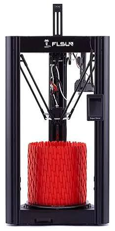 | 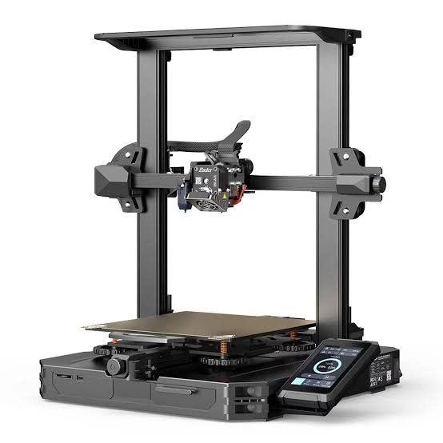 |
| :---: | :---: | :---: | :---: | :---: |
| **FLSUN T1 Pro (#1/#2)**<br />Delta Klipper · `Ø260×330` | **FLSUN V400**<br />Delta Klipper · `Ø300×410` | **Creator 5 Pro**<br />CoreXY 4-Tool (`T0–T3`) | **FLSUN Super Racer**<br />Delta · `Ø260×330` · `15 mm³/s` | **Ender 3 S1 Pro**<br />Marlin 2 · `220×220×270` |

</div>

| Impresora | Perfil Base | Cinemática | Volumen | Protocolo |
| :--- | :--- | :--- | :--- | :--- |
| **FLSUN T1 Pro #1 / #2** | `flsun_t1_pro` | Delta Klipper | `Ø260 × 330 mm` | Moonraker HTTP (`:7125`) + Cámara MJPEG |
| **FLSUN V400** | `flsun_v400` | Delta Klipper | `Ø300 × 410 mm` | Moonraker HTTP (`:80`) + Cámara MJPEG |
| **FlashForge Creator 5 Pro** | `creator5_pro` | CoreXY 4-Tool (`T0–T3`) | `256 × 256 × 256 mm` | FlashForge LAN (`:8898` / TCP `:8899`) |
| **FLSUN Super Racer** | `flsun_sr` | Delta Marlin/Klipper | `Ø260 × 330 mm` | USB Serial (`pyserial`) / SD |
| **Creality Ender 3 S1 Pro** | `ender3_s1_pro` | Cartesiana Marlin 2 | `220 × 220 × 270 mm` | USB Serial (`pyserial`) / Volumen SD |

---

## Arquitectura del Sistema

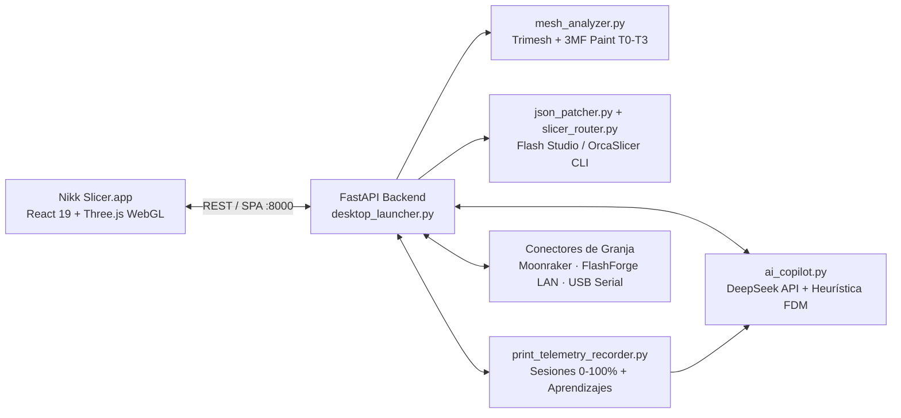

```text
MaoSlicer/
├── backend/
│   ├── app/
│   │   ├── main.py                      # API FastAPI + servidor SPA unificado (:8000)
│   │   ├── config.py                    # Catálogo, temperaturas óptimas y negociación T0–T3
│   │   ├── connectors/                  # moonraker.py, flashforge_lan.py, marlin_serial.py
│   │   ├── core/                        # mesh_analyzer.py, json_patcher.py, slicer_router.py,
│   │   │                                # gcode_postprocessor.py, ai_copilot.py,
│   │   │                                # print_telemetry_recorder.py, project_store.py
│   │   └── models/schemas.py            # Esquemas Pydantic
│   ├── profiles/                        # Perfiles JSON maestros (machines, filaments, process)
│   ├── printers_config.json             # IPs, puertos y metadatos de granja
│   ├── requirements.txt
│   └── .env.example
├── frontend/
│   ├── src/components/                  # SlicerWizard.tsx, Viewport3D.tsx, FarmDashboard.tsx,
│   │                                    # QuoteCalculatorModal.tsx, ErrorJournalModal.tsx
│   ├── src/services/api.ts
│   ├── src/utils/threeMfPaint.ts        # Decodificador 3MF pintado por triángulo (WebGL)
│   └── dist/                            # Build React/Vite listo para servir desde FastAPI
├── docs/
│   ├── assets/                          # Logos DeepSeek/Klipper/FlashForge/Creality y fotos reales
│   └── screenshots/                     # Capturas reales de la aplicación
├── desktop_launcher.py                  # Lanzador nativo macOS (puerto 8000 + ventana dedicada)
├── build_macos_app.sh                   # Empaquetador de Nikk Slicer.app + NikkSlicer.icns
├── install_on_mac.sh                    # Instalador automático (.venv + .env + Nikk Slicer.app)
├── package_release.sh                   # Generador de DMG y ZIP distribuibles
├── LICENSE                              # Licencia MIT
└── README.md
```

---

## Instalación en Otro Mac (Apple Silicon M1/M2/M3/M4 e Intel)

> **Requisitos previos en el Mac destino (Laminadores y Herramientas):**
>
> Nikk Slicer actúa como orquestador unificado, visor 3D, copiloto IA y controlador de granja; **no incluye los binarios pesados de los laminadores dentro del `.dmg`**, por lo que debes tener instalados previamente los motores en `/Applications/`:
>
> 1. **Laminadores CLI requeridos en `/Applications/`:**
>    - **Flash Studio** (`/Applications/Flash Studio.app`) — **Motor CLI primario obligatorio** (utilizado para laminar modelos de FlashForge Creator 5 Pro, FLSUN T1 Pro / V400 / SR y Ender 3 S1 Pro).
>    - **OrcaSlicer** (`/Applications/OrcaSlicer.app`) — *Recomendado como motor CLI alternativo/respaldo* (si lo instalas o prefieres cambiar la ruta, puedes definir `FLASH_STUDIO_CLI` en `backend/.env`).
>    - **FLSUN Slicer** (`/Applications/FlsunSlicer.app`) — *Opcional* (referencia de perfiles FLSUN).
> 2. **Python 3.10+** (`brew install python@3.11`).
> 3. **Ventana nativa macOS:** `pywebview` viene incluido en `requirements.txt` para abrir una ventana nativa Cocoa/WebKit (sin abrir el navegador); admite fallback automático a **Google Chrome** en modo app si es necesario.

### Método A: Instalación en un clic con `NikkSlicer_macOS_Installer.dmg`
1. Descarga **`NikkSlicer_macOS_Installer.dmg`** desde [GitHub Releases](https://github.com/alzheimeer/nikk-slicer/releases/latest) y ábrelo con doble clic.
2. Ejecuta **`Instalar_Nikk_Slicer.command`** (copiará el proyecto a `~/Apps/NikkSlicer`, creará el `.venv`, instalará dependencias e instalará **`/Applications/Nikk Slicer.app`**).
3. Edita `~/Apps/NikkSlicer/backend/.env` y pega tu clave **`DEEPSEEK_API_KEY=...`**.
4. Abre **Nikk Slicer** desde `/Applications/Nikk Slicer.app` o desde el Dock.

### Método B: Clonado desde GitHub
```bash
git clone https://github.com/alzheimeer/nikk-slicer.git
cd nikk-slicer
./install_on_mac.sh
```
Luego edita `backend/.env` con tu `DEEPSEEK_API_KEY` y abre **`/Applications/Nikk Slicer.app`**.

### Método C: Acceso Directo por Red Local (sin instalar en el segundo Mac)
Si `NIKKSLICER_HOST=0.0.0.0` y `NIKKSLICER_PORT=8000` están configurados en `backend/.env`, basta con abrir Nikk Slicer en el Mac principal y entrar desde el navegador de cualquier otro Mac o iPad de tu red local en:
```text
http://<IP_DEL_MAC_PRINCIPAL>:8000
```

---

## Endpoints REST Principales

| Método | Ruta | Descripción |
| :--- | :--- | :--- |
| `GET` | `/api/health` | Estado del servidor unificado (`Nikk Slicer`) |
| `POST` | `/api/analyze-mesh` | Análisis geométrico (`trimesh`), rangos Z `.3mf` y detección multicolor |
| `POST` | `/api/ai/orientations` | Evaluación multi-orientación (`trimesh` + DeepSeek) con viabilidad física |
| `POST` | `/api/ai/analyze-model` | Análisis IA contextual con 6 resoluciones (`0.08–0.28 mm`) |
| `POST` | `/api/ai-recommend` | Recomendación automática con DeepSeek + aprendizajes reales |
| `POST` | `/api/ai-support-orient` | Orientación anti-soportes y evaluación comparativa |
| `POST` | `/api/slice` | Laminado real multi-perfil, multi-extrusor (`T0–T3`) y pausas por capa |
| `POST` | `/api/slicer/apply-pauses` | Inyección/actualización instantánea de pausas (`PAUSE` / `M25`) sin re-laminar |
| `GET` | `/api/printers/status` | Telemetría en vivo de toda la granja + ingestión continua |
| `GET` | `/api/printers/{id}/telemetry-session` | Sesión activa grabada (`0–100%`) e historial de compendios |
| `POST` | `/api/printers/{id}/telemetry-session/compendium` | Genera compendio IA acumulado hasta el instante actual |
| `GET` | `/api/telemetry/learnings` | Aprendizajes reales acumulados por máquina y material |

---

## Actualizar y Recompilar tras Cambios en el Código

- **Recompilar frontend y actualizar `Nikk Slicer.app` + `/Applications/Nikk Slicer.app`:**
  ```bash
  ./build_macos_app.sh
  ```
- **Generar nuevos instaladores `.dmg` y `.zip` en `dist_release/`:**
  ```bash
  ./package_release.sh
  ```

---

## Apoya el Proyecto (Opcional)

**Nikk Slicer** es **100% gratuito y de código abierto (MIT)**. Si esta herramienta te ahorra tiempo en tu taller o granja de impresión 3D, puedes apoyar voluntariamente su desarrollo y pruebas reales mediante cualquiera de estas opciones:

- **Internacional (PayPal):** [paypal.me/niklaussMauricio](https://paypal.me/niklaussMauricio)
- **Colombia — Llave Bre-B (transferencia inmediata sin comisión):** `@NIKLAUSS`
- **Colombia — Nequi:** `319 377 9313`

---

## Licencia y Autor

Distribuido bajo licencia **[MIT](LICENSE)** · © 2026 **Niklauss Mauricio Quintero Romero** (`niklaussmauricio@gmail.com`)
