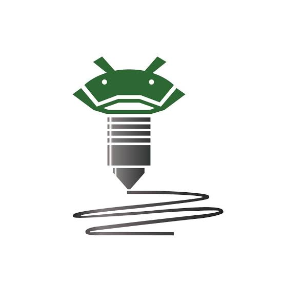
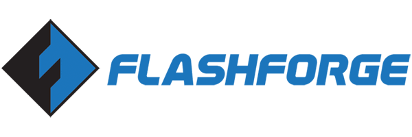
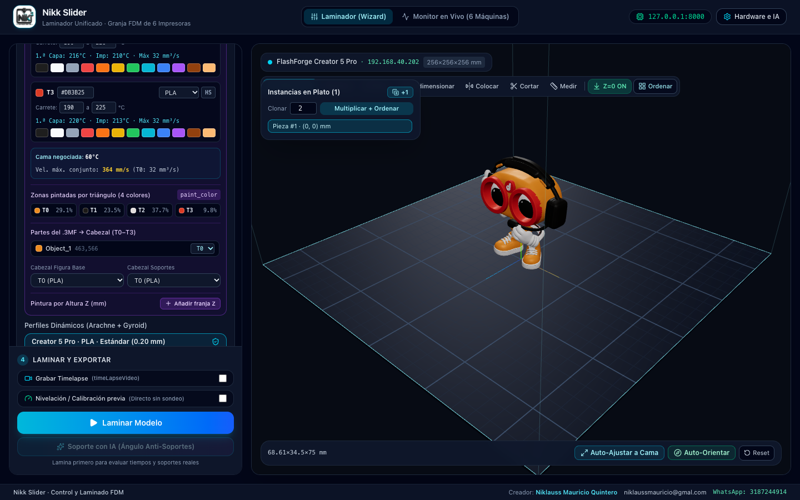
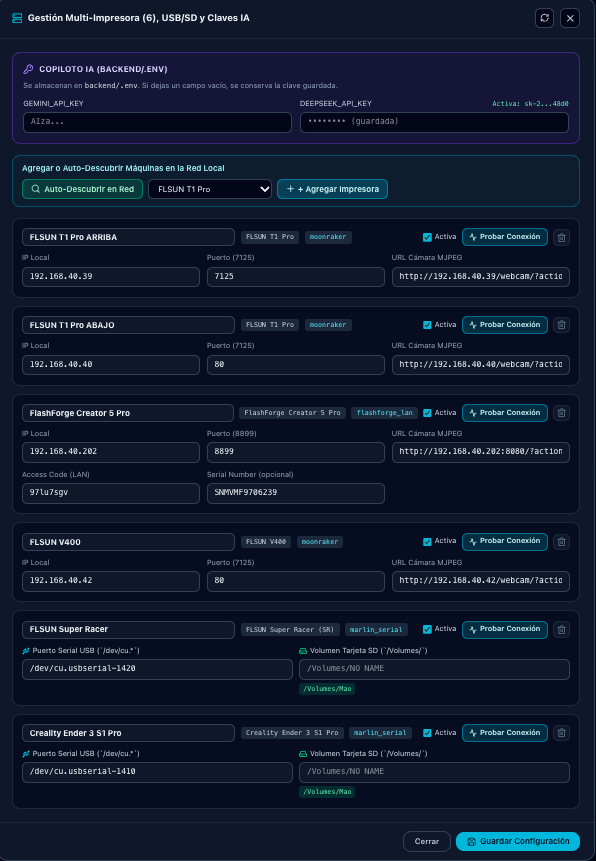
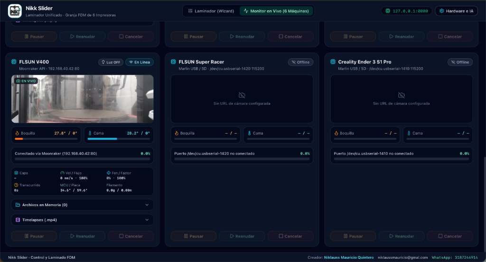
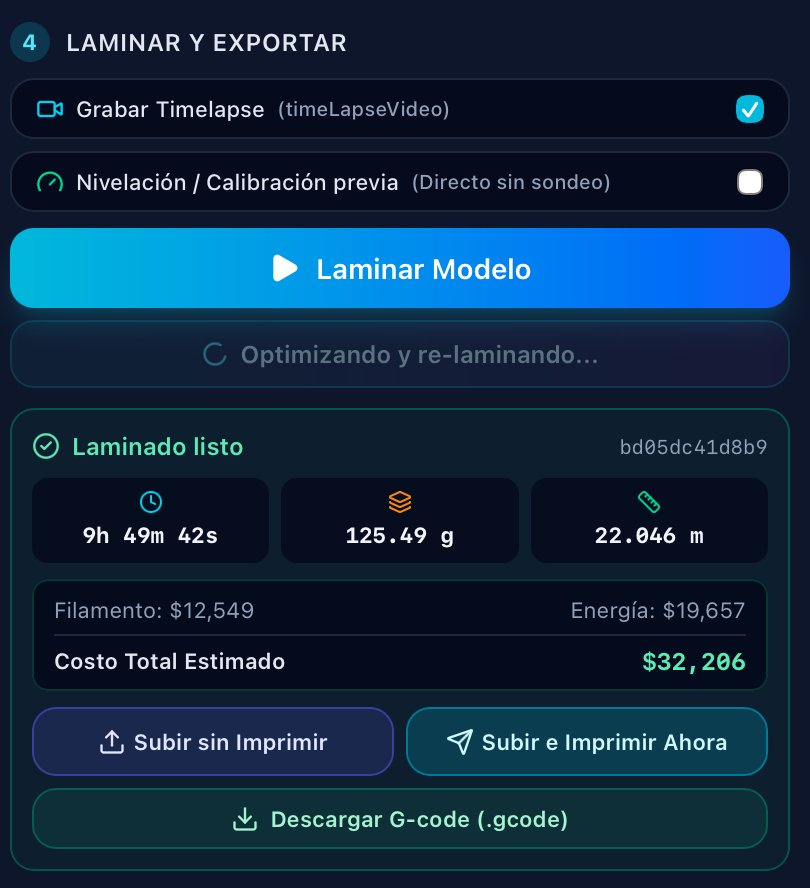
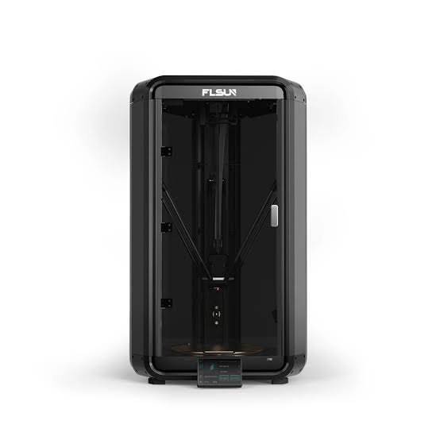
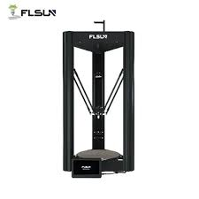
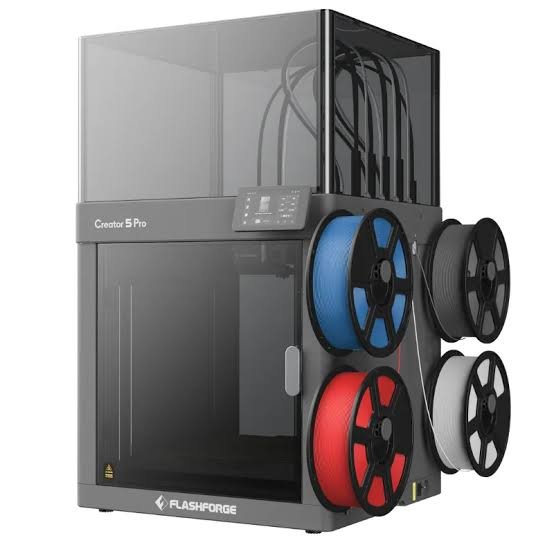
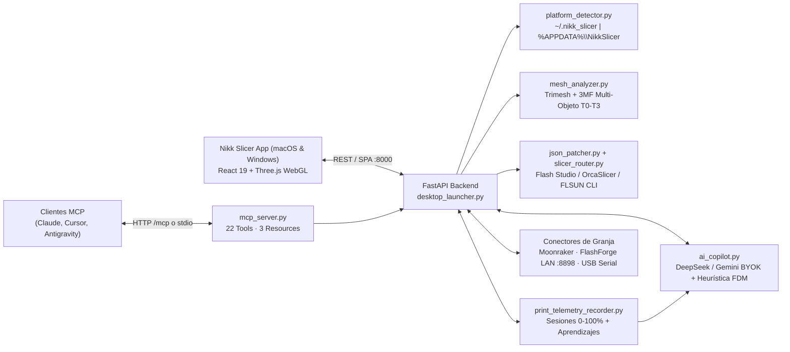

<div align="center">

**🌐 Idioma:** Español | [English](README.en.md)


# Nikk Slicer · AI & MCP Server

**Unified 3D Slicer, MCP Server & Multi-Printer Farm Monitor for macOS & Windows — FLSUN Klipper/Moonraker + FlashForge LAN**  
*Laminador 3D unificado, visor WebGL multicolor multi-objeto, servidor MCP interno y centro de control de granja FDM con Copiloto IA (DeepSeek / Gemini) para macOS y Windows.*

[](https://github.com/alzheimeer/nikk-slicer/releases/latest)
[](https://github.com/alzheimeer/nikk-slicer/actions/workflows/build-windows.yml)
[](https://fastapi.tiangolo.com/)
[](https://react.dev/)
[](https://www.deepseek.com/)
[](https://modelcontextprotocol.io/)
[](LICENSE)
[](https://github.com/alzheimeer/nikk-slicer/releases/latest)
[](https://github.com/alzheimeer/nikk-slicer/releases/latest)
[](https://paypal.me/niklaussMauricio)

[Características](#-características-principales) • [Ecosistema & Hardware](#-ecosistema-e-impresoras-soportadas) • [MCP & IA](#-arquitectura-multiplataforma-ia-dual-y-servidor-mcp) • [Galería](#-galería-de-interfaces) • [Arquitectura](#-arquitectura-del-sistema) • [Descarga e Instalación](#-descarga-e-instalación-macos-dmg-y-windows-exe) • [API](#-endpoints-rest-y-mcp-principales)

<br />

🌐 **Web Oficial (GitHub Pages):** [**https://alzheimeer.github.io/nikk-slicer/**](https://alzheimeer.github.io/nikk-slicer/)  
📥 **Descarga oficial multiplataforma:** [**GitHub Releases (`NikkSlicer_macOS.dmg` y `NikkSlicer_Windows_Setup.exe`)**](https://github.com/alzheimeer/nikk-slicer/releases/latest)

</div>

---

## Ecosistema Integrado

<div align="center">

|  |  |  |  |
| :---: | :---: | :---: | :---: |
| **DeepSeek AI Copilot** | **Klipper / Moonraker** | **FlashForge LAN & Studio** | **Creality Marlin 2** |

</div>

Nikk Slicer integra en una sola aplicación nativa (`Nikk Slicer.app`) todo el flujo de producción FDM: análisis geométrico de `.STL` y `.3MF`, optimización automática impulsada por **DeepSeek API**, laminado headless con **Flash Studio / OrcaSlicer**, envío directo a impresoras en red/USB/SD y grabación continua de telemetría (`0% → 100%`) con aprendizaje automático entre corridas.

---

## Galería de Interfaces

| Laminador (Wizard) | Visor 3D Multicolor (`T0–T3` · `paint_color`) |
| :---: | :---: |
|  |  |

| Modo Litofanía (Alta Definición) | Monitor en Vivo & Compendios IA |
| :---: | :---: |
|  |  |

| Capas G-code 3D & Soporte con IA Real | Gestión Multi-Impresora, USB/SD y Claves IA |
| :---: | :---: |
|  |  |

| Granja en Vivo (Moonraker + FlashForge LAN) | Granja en Vivo (V400 + USB Serial Marlin) |
| :---: | :---: |
|  |  |

| Parámetros Térmicos por Carrete | Perfiles Dinámicos (`Arachne + Gyroid`) |
| :---: | :---: |
|  |  |

| Laminado Listo, Costos y Envío | Compendio Final IA (`DeepSeek API`) |
| :---: | :---: |
|  |  |

| Catálogo Universal de Impresoras (`273` Modelos) | Calculadora Comercial de Cotización 3D (`COP$`) |
| :---: | :---: |
|  |  |

---

## Características Principales

- **Catálogo Universal de Impresoras (`273` modelos · `25` marcas desde OrcaSlicer):**
  - Buscador instantáneo por marca o modelo (Bambu, Creality, Prusa, Voron, Anker, Anycubic, Elegoo, FLSUN, FlashForge, etc.), filtro por marca y toggle **`Solo Multicolor`**, con botón **`Sincronizar OrcaSlicer`**.
  - Detección automática de volumen de cama, cinemática, `Q_max`, diámetro de boquilla (`0.4 mm`), sistema multicolor (`AMS / CFS / ACE / MMU`) y selección de modo de conexión (**`Red LAN / Klipper`** con IP opcional o **`Exportar .gcode USB/SD`**) para agregar cualquier máquina al taller en un clic.

- **Escena `.3mf` Multi-Objeto Independiente, Corte Planar, Deshacer/Rehacer y Exportación Multi-Formato (`Viewport3D.tsx`):**
  - Al abrir un `.3mf` con múltiples piezas, extrae cada objeto por separado preservando nombre, posición/rotación/escala original y colores `T0–T3` (`paint_color`) sin fusionarlos en un solo bloque; incluye división geométrica conservando multicolor (`POST /api/models/split-objects`), unión de objetos, corte planar por triángulo con `rtree` (`POST /api/cut-mesh` — superior, inferior o ambos con tapado automático) y auto-ordenado en cama (`POST /api/auto-arrange`).
  - **Multi-selección real (`1`, `Varios` o `Todos`):** clic simple, `Shift/Cmd + Clic`, selección por recuadro (*Box / Marquee Select*) y checkboxes individuales en `Instancias en Plato`.
  - **Gizmos `X / Y / Z` siempre visibles:** renderizados con `depthTest = false`, `depthWrite = false` y `renderOrder = 999` sobre el centroide de la pieza o grupo seleccionado.
  - **Historial Deshacer / Rehacer (`useSessionHistory.ts`):** hasta **80 pasos** mediante barra superior o atajos **`Ctrl+Z` / `Cmd+Z`** y **`Ctrl+Shift+Z` / `Ctrl+Y` / `Cmd+Shift+Z`** (posiciones, rotaciones, escalas, overrides, pintura y parámetros de corte).
  - **Exportación Multi-Formato (`POST /api/export-selection`):** exporta las piezas seleccionadas o todo el plato a **`.3MF`** (multi-objeto con pintura), **`.STL` binario** o **`.OBJ`**, con opción de aplicar transformaciones y centrar en `(0, 0) Z=0` o conservar la posición exacta en cama.
- **Pintura de Soportes 3D, Sobrescrituras Por Pieza y Estilos Avanzados (`supportPaint.ts`):**
  - **Pintura de Soportes por Triángulo:** **Pincel Esférico** (`1–25 mm` en espacio mundial real) y **Relleno Inteligente** (*Smart Fill* adaptativo, ángulo `35°` por defecto) para **Forzar (Verde)**, **Bloquear (Rojo)** o **Borrar** (*Clic izq.* = herramienta activa, *Clic der.* = Bloquear, *Shift + Clic* = Borrar), con resaltado de voladizos y modos **Auto + Bloqueadores** o **Solo Forzadores**.
  - **Compatibilidad real con OrcaSlicer / Flash Studio:** codifica `paint_supports` (`"4"` / `"8"`) por triángulo en `3D/3dmodel.model` **y** genera volúmenes 3D `subtype="support_blocker"` en `Metadata/model_settings.config`.
  - **Controles `Global | Por Pieza` y Estilos de Soporte:** anula soportes (*Global / Árbol / Normal / No*) y adhesión (*Global / Sin Balsa / Brim / Raft*) por instancia en cama, y elige estilos (`tree_slim`, `tree_strong`, `tree_hybrid`, `organic`, `grid`, `snug`).
- **Inspector de Perfil OrcaSlicer & Sidecar Automático `.json` (`ProfileInspectorDrawer.tsx`):**
  - Panel interactivo de **7 pestañas** (*Calidad*, *Fuerza*, *Velocidad*, *Soportes*, *Multimaterial*, *Otros* y *Filamentos*) con buscador de parámetros y edición directa + **`Aplicar y Re-laminar`** sobre el último corte.
  - Cada laminado guarda la instantánea efectiva en `sliced_profile_snapshot.json`, la embebe como comentario `; NIKK_SLICER_PROFILE_JSON:` en el `.gcode` y genera un sidecar **`<nombre>.json`** junto al archivo exportado (consultable también vía MCP).
- **Gestor de Proyectos `.nikkproj`, Carga Progresiva y Ventana Maximizada (`project_manager.py`):**
  - Arranque desktop siempre maximizado en Windows y macOS (`maximized=True` + `window.maximize()` en `desktop_launcher.py`).
  - Menú nativo **`Archivo`** (*Nuevo*, *Abrir proyecto* con galería de miniaturas 3D separada en pestañas **Proyectos Guardados** y **Diagnóstico Post-Impresión**, *Guardar*, *Guardar como*, *Cerrar proyecto*, *Recientes*) y restauración íntegra de escena multi-objeto (piezas divididas, transformaciones, overrides por pieza y pintura de soportes sin sobrescribir tus ajustes al reabrir).
  - **Modal bloqueante de carga (`Cargando...` `0% → 100%`):** oculta el canvas 3D mientras restaura metadatos (`20%`), geometría multicolor (`55%`), piezas/posiciones (`85%`) y escena lista (`100%`).
  - Soporte multi-ventana con color distintivo automático por proyecto y pestañas de cambio rápido sincronizadas en tiempo real (`BroadcastChannel("nikk_slicer_windows")`).
- **Protocolo Unificado FlashForge LAN (`:8898`) y Modal Global Progresivo (`GlobalProcessingOverlay.tsx`):**
  - **`Subir sin Imprimir`** (`printNow=false`) y **`Subir e Imprimir Ahora`** (`printNow=true`) utilizan el mismo adaptador FlashForge LAN HTTP (`:8898`) con verificación posterior en `/gcodeList` y bloqueo visual progresivo durante el envío.
- **Laminado Inteligente con Perfiles Dinámicos (`0.08–0.28 mm`) y Primera Capa Optimizada:**
  - **Slider Discreto Calidad vs. Velocidad (`0.08`, `0.12`, `0.16`, `0.20`, `0.24`, `0.28 mm`) y Relleno (Infill) previo al corte:** recalcula en tiempo real tarjetas dinámicas (*Estándar*, *Mecánico / Estructural*, *Piel Difusa / Textura*, *Litofanía HD* en `0.08–0.12 mm` y *Rapidez Extrema Blindada* en `0.24–0.28 mm`) según los límites térmicos/cinemáticos de cada impresora y material (`PLA`, `PETG`, `ABS`, `TPU`), e incluye selector rápido de **Relleno (`Auto`, `12%`, `15%`, `25%`, `50%`, `100%`)** antes de laminar.
  - Optimización de primera capa, retracción/wipe/Z-hop `0.2 mm` para **PETG** y multicolor, desplazamientos rápidos y torre de purga cercana con **Anclaje Reforzado (`Prime Tower Anti-Detachment`: brim `12–15 mm`, cono estabilizador y costillas `3 mm`)**.
  - **Análisis IA Contextual (`POST /api/ai/analyze-model`):** cubre las 6 resoluciones con variantes desplegables (incluyendo **`Relleno Sólido 100%`** para tarjetas de luz o piezas macizas), tiempos estimados según `Q_max` y filtrado estricto por geometría/modo (en Litofanía oculta materiales incompatibles y restringe alturas a `0.08 / 0.12 mm`).
  - Cálculo automático de temperaturas (`1.ª Capa` e `Impresión`), diámetro de boquilla (`0.2 / 0.4 / 0.6 / 0.8 mm`) y separación calibrada de soportes Z/XY por material.
- **Auto-Orientación IA Multi-Opción con Previsualización 3D en Vivo (`POST /api/ai/orientations`):**
  - Evalúa con `trimesh` + IA 5 orientaciones (*Posición Original*, *Espalda en Cama / Cara Libre*, *Inclinado 45°*, *Mínimo Tiempo / Menor Altura Z* y *Máxima Estabilidad / Base Amplia*) tanto de una pieza individual (`object_id`) como de toda la cama (`scene_objects_json`), con previsualización instantánea sobre la cama (`dropToBed`) antes de laminar.
  - Mide el área real de contacto en cama (`z <= 0.25 mm`), emite alertas de estabilidad (`Base muy pequeña · Requiere Brim/Balsa y Soportes`) y asigna badges dinámicos reales (`Sin Soportes` únicamente cuando los voladizos son `<= 2.0%`).
- **Gestor Universal de Pausas por Capa (`POST /api/slicer/apply-pauses`):**
  - Botón **`+ Pausa aquí`** (con nota opcional) y marcadores visuales en la barra vertical de capas del visor G-code, además del bloque **Pausas Programadas** en el Paso 4 y resumen en **Laminado listo**.
  - Inyección instantánea en el `.gcode` sin re-laminar (`< 50 ms`) y conservación automática al volver a laminar: `PAUSE` para impresoras **Klipper** y bloque seguro `G91 / G1 Z10 / M25 / G1 Z-10` para **FlashForge Creator 5 Pro**.
- **Soporte con IA (Antes vs. Después Real):**
  - Al pulsar **Soporte con IA (Ángulo Anti-Soportes)**, el sistema evalúa candidatos de orientación con `trimesh`, aplica la rotación y configuración recomendadas, **re-lamina realmente** en segundo plano y compara tiempo, gramos totales y peso de soporte contra el corte previo; si no mejora, revierte automáticamente a la configuración original.
- **Multicabezal 4 Extrusores (`T0–T3`) y Mapeo Extendido (+4 Colores) para FlashForge Creator 5 Pro:**
  - Decodificación nativa de archivos **`.3mf` pintados por triángulo** (`paint_color` de Bambu/Orca/Meshy AI y `pid`/`p1`) tanto en el visor 3D (sin sangrado entre vértices) como en el laminador headless.
  - **Mapeo Extendido Multicolor (+4 Colores):** analiza rangos `[z_min_mm, z_max_mm]` por parte tras rotación/escala, sugiere ranuras físicas `T0–T3` reutilizables sin cruce en Z, valida conflictos en vivo e inyecta automáticamente la pausa `M25` en el cambio de filamento.
  - Configuración térmica, de material (`PLA`, `PETG`, `ABS`, `TPU 95A`, `Soporte`), modo `HS`, rango de carrete y retracción **independiente por cabezal (`T0–T3`)**, más **Torre de Purga Ultra-Ahorro** (`20 mm` + purga en relleno y soportes).
- **Modo Litofanía (Alta Definición a Contraluz):**
  - Bloqueo automático a **PLA / PLA HS**, capa fina (`0.08–0.12 mm`), relleno **`99%` rectilíneo**, 6 perímetros (`Arachne`), costura trasera, brim exterior de `8 mm`, desactivación de soportes sobre la cara de imagen y velocidades/aceleraciones anti-ringing por cinemática.
- **Calculadora Comercial de Cotización 3D (`QuoteCalculatorModal`):**
  - Acceso desde **Laminado listo** (`Calculadora de Venta` pre-rellenada con impresora/Watts, horas/minutos y gramos reales) o desde la barra superior (**Cotizar**).
  - Calcula costo real en `COP$` (filamento, tarifa Enel Bogotá, desgaste por vida útil/repuestos, margen de fallo, insumos extra, pintura/mano de obra, comisiones de plataforma, multiplicadores `×2`–`×5` y **descuentos por volumen `0–50%` sobre ganancia neta** con tramos automáticos editables según unidades `1–9`, `10–24`, `25–49`, `50–99`, `100+`), con copia formateada para **WhatsApp** y guardado de preset de taller.
- **Monitor en Vivo, Reporte de Errores de Firmware, Cámaras y Aprendizaje Continuo con IA:**
  -  **Grabador continuo (`0% → 100%`)** en segundo plano: guarda muestras cada 20 s y en hitos de progreso (`backend/temp/telemetry_sessions/`).
  - **Alertas de Firmware en Tiempo Real (`FarmDashboard.tsx`):** captura y muestra banners con código y causa en vivo desde **FlashForge LAN** (catálogo `E0161–E0164`, `E0011`, `E0017` con slot activo de filamento), **Klipper/Moonraker** (`webhooks.state`, shutdown y motivo de pausa) y **Marlin USB Serial** (`error:` / `!!`).
  - **Auto-suspensión y limpieza de sockets MJPEG:** suspende cámaras tras 5 minutos, libera explícitamente el socket `` al desmontar/pausar la tarjeta mientras está en modal de pantalla completa (`pausedExternal`) y reintenta cada 4 s ante streams de 1 cliente (como Creator 5 Pro).
  - Al finalizar la impresión (o bajo demanda a mitad de corrida), genera un **Compendio Final IA** por fases (`0–5%`, `5–85%`, `85–100%`) con calificación (`EXCELENTE`, `BUENA_CON_MEJORAS`, `REQUIERE_AJUSTE`) y mejoras concretas para el siguiente laminado.
  - **Aprendizaje real acumulado (`GET /api/telemetry/learnings`):** el historial completado (`completed_compendiums.json`) retroalimenta automáticamente a DeepSeek/Gemini en el Paso 3 del Laminador según máquina y material.
  - Control aislado de **Luz LED**, gestor de **archivos remotos** (subir sin imprimir, subir e imprimir con/sin nivelación y **borrado masivo** de G-codes), reproductor/descarga de **Timelapses `.mp4`** y cancelación real (`END_PRINT` en Moonraker / FlashForge LAN).
- **Cálculo de Costos de Producción en Tiempo Real:**
  - Estimación automática del costo de **filamento**, **consumo eléctrico por hora** y **costo total de la pieza** junto con el tiempo de impresión, gramos y metros antes de enviar o descargar el `.gcode`.

---

## Arquitectura Multiplataforma, IA Dual y Servidor MCP

- **Auto-Detección de Laminadores (`backend/app/core/platform_detector.py`):**
  - Carpeta de usuario unificada (`~/.nikk_slicer/` en macOS/Linux y `%APPDATA%\NikkSlicer\` en Windows) sin rutas hardcodeadas.
  - Escaneo determinista en `darwin` y `win32` para detectar **OrcaSlicer**, **Orca-Flashforge / Flash Studio** y **FLSun Slicer**, actualizando automáticamente el ejecutable CLI activo.
- **Asistente `Entorno / MCP` (`SystemSetupModal.tsx`):**
  - Se abre automáticamente en el primer arranque si falta el laminador primario y está disponible en todo momento desde el botón **`Entorno / MCP`** de la barra superior.
  - Permite re-escanear el equipo, abrir enlaces oficiales de descarga, seleccionar manualmente un ejecutable (vía selector nativo `DesktopApi.pick_slicer_executable`) y probar la conexión IA.
- **Soporte Dual de API Key (BYOK — DeepSeek / Google Gemini):**
  - El usuario elige entre **DeepSeek** o **Google Gemini** e introduce su propia API Key desde el asistente `Entorno / MCP` (`POST /api/system/ai-config` + `POST /api/system/ai-test`).
- **Servidor MCP Interno Autodescubierto (`backend/app/mcp_server.py`):**
  - Basado en el SDK oficial `mcp` (`MCPServer("NikkSlicerMCP")`), expone **24 herramientas** (entorno/IA, análisis/división/auto-ordenado/orientación 3D, copiloto IA, laminado, **sincronización y re-laminado en vivo de la ventana abierta**, pausas por capa, cotización COP, proyectos guardados, snapshot de perfil, catálogo universal de impresoras y telemetría/control) y **3 recursos** (`nikk://printers`, `nikk://projects/recent`, `nikk://environment`).
  - Disponible por **Streamable HTTP** en `http://127.0.0.1:8000/mcp` (montado en FastAPI) y por **`stdio`** mediante `python3 -m backend.app.mcp_server`, con botón de copia rápida de configuración JSON dentro de `Entorno / MCP`.

---

## Ecosistema e Impresoras Soportadas

<div align="center">

|  |  |  |  |  |
| :---: | :---: | :---: | :---: | :---: |
| **FLSUN T1 Pro (#1/#2)**<br />Delta Klipper · `Ø260×330` | **FLSUN V400**<br />Delta Klipper · `Ø300×410` | **Creator 5 Pro**<br />CoreXY 4-Tool (`T0–T3`) | **FLSUN Super Racer**<br />Delta · `Ø260×330` · `15 mm³/s` | **Ender 3 S1 Pro**<br />Marlin 2 · `220×220×270` |

</div>

| Impresora | Perfil Base | Cinemática | Volumen | Protocolo |
| :--- | :--- | :--- | :--- | :--- |
| **FLSUN T1 Pro #1 / #2** | `flsun_t1_pro` | Delta Klipper | `Ø260 × 330 mm` | Moonraker HTTP (`:7125`) + Cámara MJPEG |
| **FLSUN V400** | `flsun_v400` | Delta Klipper | `Ø300 × 410 mm` | Moonraker HTTP (`:80`) + Cámara MJPEG |
| **FlashForge Creator 5 Pro** | `creator5_pro` | CoreXY 4-Tool (`T0–T3`) | `256 × 256 × 256 mm` | FlashForge LAN (`:8898` / TCP `:8899`) |
| **FLSUN Super Racer** | `flsun_sr` | Delta Marlin/Klipper | `Ø260 × 330 mm` | USB Serial (`pyserial`) / SD |
| **Creality Ender 3 S1 Pro** | `ender3_s1_pro` | Cartesiana Marlin 2 | `220 × 220 × 270 mm` | USB Serial (`pyserial`) / Volumen SD |

---

## Arquitectura del Sistema



```text
nikk-slicer/
├── .github/workflows/
│   ├── build-macos.yml                  # Pipeline CI/CD macOS -> NikkSlicer_macOS.dmg
│   └── build-windows.yml                # Pipeline CI/CD Windows -> NikkSlicer_Windows_Setup.exe
├── backend/
│   ├── app/
│   │   ├── main.py                      # API FastAPI + servidor SPA (:8000) + montaje /mcp
│   │   ├── mcp_server.py                # Servidor MCP interno (22 herramientas + 3 recursos)
│   │   ├── config.py                    # Catálogo, temperaturas óptimas y negociación T0–T3
│   │   ├── connectors/                  # moonraker.py, flashforge_lan.py, marlin_serial.py
│   │   ├── core/                        # platform_detector.py, mesh_analyzer.py, json_patcher.py,
│   │   │                                # slicer_router.py, gcode_postprocessor.py, ai_copilot.py,
│   │   │                                # print_telemetry_recorder.py, project_manager.py,
│   │   │                                # project_store.py, orca_catalog.py, printer_registry.py
│   │   └── models/schemas.py            # Esquemas Pydantic
│   ├── profiles/                        # Perfiles JSON maestros (machines, filaments, process)
│   ├── printers_config.json             # IPs, puertos y metadatos de granja
│   ├── requirements.txt
│   └── .env.example
├── frontend/
│   ├── src/components/                  # SlicerWizard.tsx, Viewport3D.tsx, FarmDashboard.tsx,
│   │                                    # ProfileInspectorDrawer.tsx, SystemSetupModal.tsx,
│   │                                    # GlobalProcessingOverlay.tsx, QuoteCalculatorModal.tsx,
│   │                                    # AddPrinterModal.tsx, ErrorJournalModal.tsx
│   ├── src/hooks/useSessionHistory.ts   # Historial Undo / Redo global (hasta 80 pasos)
│   ├── src/services/api.ts
│   ├── src/utils/supportPaint.ts        # Pincel esférico y Relleno Inteligente de soportes 3D
│   ├── src/utils/threeMfPaint.ts        # Decodificador 3MF pintado por triángulo (WebGL)
│   └── dist/                            # Build React/Vite listo para servir desde FastAPI
├── docs/
│   ├── assets/                          # Logos DeepSeek/Klipper/FlashForge/Creality y fotos reales
│   └── screenshots/                     # Capturas reales de la aplicación
├── desktop_launcher.py                  # Lanzador nativo macOS & Windows (puerto 8000 + menú Archivo)
├── build_macos_app.sh                   # Empaquetador autónomo PyInstaller de Nikk Slicer.app + NikkSlicer.icns
├── build_macos_dmg.sh                   # Generador de NikkSlicer_macOS.dmg (UDZO + /Applications)
├── build_windows.ps1                    # Empaquetador Windows PyInstaller --onedir + nikk_slicer.ico
├── installer_windows.iss                # Script Inno Setup 6 -> NikkSlicer_Windows_Setup.exe
├── install_on_mac.sh                    # Instalador automático macOS (.venv + .env + Nikk Slicer.app)
├── package_release.sh                   # Generador de paquetes locales en dist_release/
├── LICENSE                              # Licencia MIT
└── README.md
```

---

## Descarga e Instalación (macOS `.dmg` y Windows `.exe`)

Descarga el instalador correspondiente desde [**GitHub Releases**](https://github.com/alzheimeer/nikk-slicer/releases/latest):

- **macOS (Apple Silicon & Intel):** **`NikkSlicer_macOS.dmg`** (bundle `Nikk Slicer.app` 100% autónomo con runtime Python, dependencias y frontend incluidos).
- **Windows 10 / 11 (x64):** **`NikkSlicer_Windows_Setup.exe`** (instalador Inno Setup con Edge WebView2, accesos directos y asociaciones opcionales `.3mf` / `.stl`).

### 1. Instalación Rápida
- **En macOS:** abre [**`NikkSlicer_macOS.dmg`**](https://github.com/alzheimeer/nikk-slicer/releases/latest/download/NikkSlicer_macOS.dmg) y arrastra **`Nikk Slicer.app`** a **`Applications`**.
  > **Nota macOS (primer arranque):** como la app usa firma ad-hoc local, si macOS muestra aviso de desarrollador no identificado al abrirla por primera vez, haz **clic derecho → Abrir** o ejecuta `xattr -cr "/Applications/Nikk Slicer.app"`.
- **En Windows:** descarga y ejecuta [**`NikkSlicer_Windows_Setup.exe`**](https://github.com/alzheimeer/nikk-slicer/releases/latest/download/NikkSlicer_Windows_Setup.exe), sigue el asistente (opcionalmente marca la asociación de archivos `.3mf` / `.stl`) e inicia **Nikk Slicer** desde el Menú Inicio o el Escritorio.

### 2. Auto-Detección de Motores de Laminado
Al iniciar, Nikk Slicer escanea automáticamente tu equipo (sin requerir rutas manuales) para detectar:
- **OrcaSlicer** (`/Applications/OrcaSlicer.app` en macOS · `orca-slicer.exe` en Windows)
- **FLSun Slicer** (`/Applications/FlsunSlicer.app` en macOS · `FlsunSlicer.exe` en Windows)
- **Orca-Flashforge / Flash Studio / FlashPrint** (`/Applications/Flash Studio.app` / `Orca-Flashforge.app` en macOS · `Orca-Flashforge.exe` / `FlashPrint.exe` en Windows)

Si alguno falta, el asistente **`Entorno / MCP`** muestra enlaces directos de descarga oficial y un botón para ubicar el ejecutable manualmente.

### 3. Consigue tu API Key de DeepSeek (o Google Gemini)
Desde el botón **`Entorno / MCP`** en la barra superior puedes elegir tu proveedor de IA (**DeepSeek** o **Google Gemini**), pegar tu API Key y validarla con **`Probar conexión`** (se guarda localmente en `~/.nikk_slicer/` en macOS/Linux o `%APPDATA%\NikkSlicer\` en Windows).

> 🔑 **Consigue tu API Key de DeepSeek:** [**https://platform.deepseek.com/sign_in**](https://platform.deepseek.com/sign_in)
> 1. Inicia sesión en **DeepSeek Platform** y ve a **`Top up`** para recargar saldo. **Con solo $5 USD alcanza para muchísimo:** en uso real, más de **350 consultas IA (~500K tokens) cuestan menos de $0.10 USD**, por lo que una recarga de $5 USD rinde para meses de análisis de modelos, orientaciones y compendios.
> 2. Entra a **`API keys` → `Create new API key`**, copia tu clave (`sk-...`) y pégala en **`Entorno / MCP`** dentro de Nikk Slicer.

### 4. Conectar el Servidor MCP (`nikk-slicer`) en Antigravity IDE, Claude Desktop o Cursor
Nikk Slicer expone **22 herramientas** y **3 recursos** MCP tanto por **Streamable HTTP** (`http://127.0.0.1:8000/mcp` cuando la app está abierta) como por **`stdio`** (`python3 -m backend.app.mcp_server`):

- **Streamable HTTP (Antigravity IDE / Cursor — con Nikk Slicer abierto):**
  ```json
  {
    "mcpServers": {
      "nikk-slicer": {
        "url": "http://127.0.0.1:8000/mcp"
      }
    }
  }
  ```
- **Stdio local (Claude Desktop / Antigravity IDE / Cursor — funciona incluso con la UI cerrada):**
  - *macOS / Linux:*
    ```json
    {
      "mcpServers": {
        "nikk-slicer": {
          "command": "/ruta/a/nikk-slicer/backend/.venv/bin/python",
          "args": ["-m", "backend.app.mcp_server"],
          "env": {
            "PYTHONPATH": "/ruta/a/nikk-slicer"
          }
        }
      }
    }
    ```
  - *Windows:*
    ```json
    {
      "mcpServers": {
        "nikk-slicer": {
          "command": "python",
          "args": ["-m", "backend.app.mcp_server"],
          "env": {
            "PYTHONPATH": "C:\\ruta\\a\\nikk-slicer"
          }
        }
      }
    }
    ```
  También puedes copiar el bloque JSON listo para pegar desde **`Entorno / MCP` → `Copiar configuración JSON MCP`**.

#### Catálogo Completo de Herramientas y Recursos MCP (`24` Tools · `3` Resources)
| Categoría | Herramientas / Recursos MCP |
| :--- | :--- |
| **Entorno e IA (4)** | `nikk_get_system_environment`, `nikk_rescan_slicers`, `nikk_set_slicer_path`, `nikk_configure_ai` |
| **Geometría 3D & `.3mf` (4)** | `nikk_analyze_model`, `nikk_split_objects`, `nikk_auto_arrange`, `nikk_evaluate_orientations` |
| **Copiloto IA & Laminado (4)** | `nikk_ai_analyze_model`, `nikk_slice_model`, `nikk_apply_layer_pauses`, `nikk_calculate_quote` |
| **Proyectos, Perfil & UI en Vivo (6)** | `nikk_list_recent_projects`, `nikk_get_project`, `nikk_delete_project`, `nikk_get_sliced_profile_snapshot`, `nikk_get_live_state`, `nikk_update_live_profile` |
| **Granja, Catálogo & Bitácora (6)** | `nikk_get_printers_status`, `nikk_upload_and_print`, `nikk_control_printer`, `nikk_get_error_journal`, `nikk_search_printer_catalog`, `nikk_add_custom_printer` |
| **Recursos MCP (3)** | `nikk://printers`, `nikk://projects/recent`, `nikk://environment` |

> **Ejemplos de uso desde tu agente IA:** *"Analiza `pieza.3mf` con Nikk Slicer, evalúa la mejor orientación sin soportes, lamina en PLA 0.16 mm para FLSUN T1 Pro, agrega una pausa en la capa 40 para insertar un imán, calcula la cotización en COP y envíalo a imprimir."*

### Compilación desde Código Fuente (Opcional)
- **macOS (`.app` y `.dmg`):**
  ```bash
  git clone https://github.com/alzheimeer/nikk-slicer.git
  cd nikk-slicer
  ./build_macos_dmg.sh   # genera dist_release/NikkSlicer_macOS.dmg
  ```
- **Windows (`.exe`):**
  ```powershell
  .\build_windows.ps1    # genera dist_release/NikkSlicer_Windows_Setup.exe
  ```

### Acceso Directo por Red Local (sin instalar en otro equipo)
Si `NIKKSLICER_HOST=0.0.0.0` y `NIKKSLICER_PORT=8000` están configurados en `backend/.env`, basta con abrir Nikk Slicer en el equipo principal y entrar desde el navegador de cualquier otro Mac, Windows o iPad de tu red local en:
```text
http://<IP_DEL_EQUIPO_PRINCIPAL>:8000
```

---

## Endpoints REST y MCP Principales

| Método | Ruta | Descripción |
| :--- | :--- | :--- |
| `GET` | `/api/health` | Estado del servidor unificado (`Nikk Slicer`) |
| `GET` | `/api/system/environment` | SO detectado, carpeta de datos de usuario, laminadores instalados y config IA/MCP |
| `POST` | `/api/system/rescan` | Re-escanea OrcaSlicer, Orca-Flashforge y FLSun Slicer en el equipo |
| `POST` | `/api/system/set-slicer-path` | Asigna manualmente la ruta de un ejecutable de laminador |
| `POST` | `/api/system/ai-config` | Guarda proveedor (`deepseek` / `gemini`) y API Key |
| `POST` | `/api/system/ai-test` | Prueba en vivo la conexión con DeepSeek o Google Gemini |
| `HTTP / stdio` | `/mcp` | Servidor MCP interno (`24` herramientas + `3` recursos: `nikk://printers`, `nikk://projects/recent`, `nikk://environment`) |
| `GET / POST` | `/api/live/state`, `/api/live/command` | Sincronización de estado abierto y re-laminado en vivo desde MCP |
| `POST` | `/api/analyze-mesh` | Análisis geométrico (`trimesh`), extracción `.3mf` multi-objeto y rangos Z |
| `POST` | `/api/models/split-objects` | División geométrica conservando `paint_color` / `T0–T3` en objetos independientes |
| `POST` | `/api/cut-mesh` | Corte planar (`trimesh` + `rtree`) en mitades superior, inferior o ambas |
| `POST` | `/api/auto-arrange` | Auto-ordenado geométrico sin colisiones sobre la cama activa |
| `POST` | `/api/export-selection` | Exportación multi-objeto a `.3MF`, `.STL` binario u `.OBJ` (con o sin transformaciones) |
| `POST` | `/api/ai/orientations` | Evaluación multi-orientación (`trimesh` + IA) por pieza o cama completa |
| `POST` | `/api/ai/analyze-model` | Análisis IA contextual con 6 resoluciones (`0.08–0.28 mm`) |
| `POST` | `/api/ai-recommend` | Recomendación automática con IA + aprendizajes reales |
| `POST` | `/api/ai-support-orient` | Orientación anti-soportes y evaluación comparativa |
| `POST` | `/api/slice` | Laminado real multi-perfil, overrides por pieza, `paint_supports`, snapshot y sidecar `.json` |
| `POST` | `/api/slicer/apply-pauses` | Inyección/actualización instantánea de pausas (`PAUSE` / `M25`) sin re-laminar |
| `GET / POST` | `/api/printers/catalog*` & `/api/printers/add` | Búsqueda/sincronización del catálogo OrcaSlicer (`273` modelos) y registro de impresoras |
| `GET / POST` | `/api/projects/*` | Guardar, listar con miniaturas y reabrir proyectos `.nikk` / recientes |
| `GET` | `/api/printers/status` | Telemetría en vivo de toda la granja + ingestión continua |
| `GET` | `/api/printers/{id}/telemetry-session` | Sesión activa grabada (`0–100%`) e historial de compendios |
| `POST` | `/api/printers/{id}/telemetry-session/compendium` | Genera compendio IA acumulado hasta el instante actual |
| `GET` | `/api/telemetry/learnings` | Aprendizajes reales acumulados por máquina y material |

---

## Actualizar y Recompilar tras Cambios en el Código

- **macOS — Recompilar frontend y actualizar `Nikk Slicer.app` + `/Applications/Nikk Slicer.app`:**
  ```bash
  ./build_macos_app.sh
  ```
- **macOS — Generar imagen distribuible `dist_release/NikkSlicer_macOS.dmg`:**
  ```bash
  ./build_macos_dmg.sh
  ```
- **Windows — Recompilar frontend y generar `dist_release/NikkSlicer_Windows_Setup.exe`:**
  ```powershell
  .\build_windows.ps1
  ```

---

## Apoya el Proyecto (Opcional)

**Nikk Slicer** es **100% gratuito y de código abierto (MIT)**. Si esta herramienta te ahorra tiempo en tu taller o granja de impresión 3D, puedes apoyar voluntariamente su desarrollo y pruebas reales mediante cualquiera de estas opciones:

- **Internacional (PayPal):** [paypal.me/niklaussMauricio](https://paypal.me/niklaussMauricio)
- **Colombia — Llave Bre-B (transferencia inmediata sin comisión):** `@NIKLAUSS`
- **Colombia — Nequi:** `319 377 9313`

---

## Licencia y Autor

Distribuido bajo licencia **[MIT](LICENSE)** · © 2026 **Niklauss Mauricio Quintero Romero** (`niklaussmauricio@gmail.com`)
